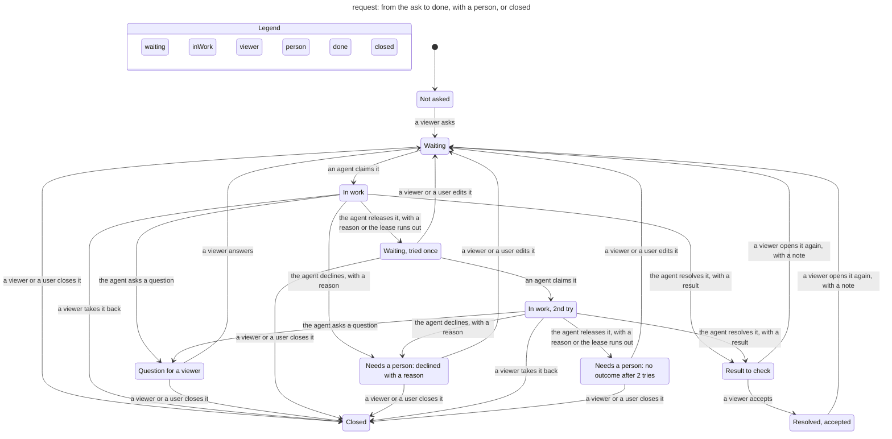

# request: the life of one request

The chart shows the states of one request, and who moves it. A viewer asks. An agent claims it.
Each try ends with one outcome: a result to check, a question for a viewer, or a decline to a
person. A release or a lease that runs out ends a try with no outcome. After 2 such tries (3 in the
spec), the request needs a person. A viewer answers a question, accepts or opens a result again,
and edits or closes a request that waits or needs a person. A viewer can also take back a request
while an agent works on it: the close ends the claim, so no result comes. A user can edit and close
from the CLI. Each return to the queue starts the count of tries again at 0.

The model is [models/request/Request.tla](models/request/Request.tla) with
[Request.cfg](models/request/Request.cfg). It has one agent, and a lease that is live or not.
[queue-lease](queue-lease.md) checks the claim, the lease and the handles between two agents. TLC
checks every rule below on all 17 states, and each one holds.



## Rules

| Rule                                        | In plain words                                                                                              | Spec line                                                               |
| ------------------------------------------- | ----------------------------------------------------------------------------------------------------------- | ----------------------------------------------------------------------- |
| `TypeOK`                                    | Each value is one that the board can hold. `tries` never goes past the cap.                                 | SPEC-queue.md § Contract                                                |
| `OnlyAnOpenRequestIsInWork`                 | Only an `open` request can be in work.                                                                      | SPEC-queue.md § Contract (the states)                                   |
| `AQuestionWaitsForAViewer`                  | A request with a question is not in the queue, and never needs a person by the count of tries.              | SPEC-queue.md § A viewer answers and decides, step 1; E4.2 M14          |
| `NoDeadlock`                                | There is always a next step. A closed request stays as it is.                                               | (model)                                                                 |
| `AViewerOnlyTakesBackARequestInWork`        | A viewer or user changes a request that an agent holds only to close it (take it back).                     | SPEC-queue.md § A viewer asks for a change, step 5; judged rule 9       |
| `ATakenBackRequestNeverShowsAResult`        | A request that is closed, also one taken back from an agent, never becomes a result.                        | SPEC-queue.md § A viewer asks for a change, step 5; E4.1 N9             |
| `ARequestComesBackWithNoTries`              | An edit, an answer or a reopen sends the request back with its count of tries at 0.                         | SPEC-queue.md § A request no agent finishes, step 3; judged rules 9, 11 |
| `AResultStaysResolvedUntilReopened`         | A result stays resolved, accepted or not, until a viewer opens it again.                                    | SPEC-queue.md § A viewer answers and decides, steps 2, 3; E4.2 M15      |
| `OnlyAPersonActsOnARequestThatNeedsAPerson` | Only an edit or a close takes a request away from "needs a person".                                         | SPEC-queue.md § A request no agent finishes, step 3; E4.3 P4            |
| `AClosedRequestStaysClosed`                 | A closed request stays closed.                                                                              | SPEC-queue.md, judged rule 9                                            |
| `EveryTryEnds`                              | A lease never stays live: each try ends.                                                                    | SPEC-queue.md, judged rule 7; E4.3 P6                                   |
| `ARequestEndsWithAnOutcomeOrAPerson`        | When no viewer acts, a request comes to rest with an outcome or with a person. It never loops in the queue. | SPEC-queue.md § A request no agent finishes, step 2; E4.3 P1            |

A check of the rules: a release that gives its try back breaks `ARequestEndsWithAnOutcomeOrAPerson`.
An answer that keeps the tries breaks `ARequestComesBackWithNoTries`. An edit of a request in work
breaks `AViewerOnlyTakesBackARequestInWork`. A take back that leaves the lease live breaks
`ATakenBackRequestNeverShowsAResult`: the agent could still resolve.

## What the model leaves out

- Two agents, handles, the order of the queue and the wait: [queue-lease](queue-lease.md).
- The text of each message, and its HTML part. A message only adds to the history (judged
  rule 9; no call changes or removes one).
- "May be outdated": a mark from the frame version, a removed frame, or the age. It changes no
  state (SPEC-queue.md § A request becomes outdated).
- Two viewers who act at the same time. Each call is one conditional write, so the second gets
  `wrongState` and writes nothing. The model makes each call one step.
- The cap. The spec says 3, and the model uses 2. The rules do not depend on the number.
- Limits (`full`, `slow`) and a removed canvas.

## Steps the chart hides

- Steps that stay in one chart state (4): an edit of a waiting request that was not tried, and
  the stop of a closed request.

## Make it again

```sh
scripts/statecharts.sh request-life          # rewrite this page's mermaid block in place if it differs
scripts/statecharts.sh --check request-life  # change nothing; compare the block and the verdict in charts.tsv
```
