# starts: only the person starts the work of an agent

The chart shows one request, from the post to the end of its work, when a NATS channel and its
starter (the Paseo adapter) start the agents. A request of the person is agreed at once. A
request of a viewer waits for the person to agree. The dispatcher publishes only an agreed
request, and an agent claims only an agreed request. A new text of a viewer ends the agreement.
The starter starts no agent while it is at a limit. Easel shows the cause of each request that
waits: no agreement, the limit, a failed start, or a refusal.

The model is [models/starts/Starts.tla](models/starts/Starts.tla) with
[Starts.cfg](models/starts/Starts.cfg). The spec is [SPEC-starts](../../SPEC-starts.md). TLC
checks every rule below on all 206 states of this model, and each one holds.

```mermaid
---
title: "starts: only the person starts the work of an agent, inside the limits"
---
stateDiagram-v2
  state "Legend" as legend {
    lg0: waiting
    lg1: held
    lg2: inWork
    lg3: out
  }
  class lg0 blue
  class lg1 orange
  class lg2 yellow
  class lg3 teal
  s0: Not posted
  s1: Waits, of a viewer, not agreed, shows: waits for the person to agree
  s2: Waits, of the person, agreed
  s3: Waits, of the person, agreed, refused, shows: the channel refused it
  s4: Waits, of the person, agreed, published
  s5: Waits, of a viewer, agreed
  s6: Waits, of a viewer, not agreed, an old message waits, shows: waits for the person to agree
  s7: Waits, of the person, agreed, published, shows: the start failed
  s8: Waits, of the person, agreed, an old message waits
  s9: Waits, of the person, agreed, published, an agent starts
  s10: Waits, of a viewer, agreed, refused, shows: the channel refused it
  s11: Waits, of a viewer, agreed, published
  s12: Waits, of a viewer, not agreed, an agent starts, shows: waits for the person to agree
  s13: In work by its agent
  s14: Waits, of the person, agreed, refused, an old message waits, shows: the channel refused it
  s15: Waits, of the person, agreed, published, an old message waits
  s16: Waits, of the person, agreed, an agent starts
  s17: Waits, of the person, agreed, published, shows: waits for the limit
  s18: Waits, of a viewer, agreed, published, shows: the start failed
  s19: Waits, of a viewer, agreed, an old message waits
  s20: Waits, of a viewer, agreed, published, an agent starts
  s21: Out of the queue
  s22: Waits, of the person, agreed, published, an old message waits, shows: the start failed
  s23: Waits, of the person, agreed, refused, an agent starts, shows: the channel refused it
  s24: Waits, of the person, agreed, published, an old message waits, an agent starts
  s25: Waits, of a viewer, agreed, refused, an old message waits, shows: the channel refused it
  s26: Waits, of a viewer, agreed, published, an old message waits
  s27: Waits, of a viewer, agreed, an agent starts
  s28: Waits, of a viewer, agreed, published, shows: waits for the limit
  s29: Waits, of a viewer, not agreed, an old message waits, an agent starts, shows: waits for the person to agree
  s30: Waits, of the person, agreed, published, an agent starts, shows: the start failed
  s31: Waits, of the person, agreed, an old message waits, an agent starts
  s32: Waits, of the person, agreed, published, an old message waits, shows: waits for the limit
  s33: Waits, of a viewer, agreed, published, an old message waits, shows: the start failed
  s34: Waits, of a viewer, agreed, refused, an agent starts, shows: the channel refused it
  s35: Waits, of a viewer, agreed, published, an old message waits, an agent starts
  s36: Waits, of the person, agreed, refused, an old message waits, an agent starts, shows: the channel refused it
  s37: Waits, of a viewer, agreed, published, an agent starts, shows: the start failed
  s38: Waits, of a viewer, agreed, an old message waits, an agent starts
  s39: Waits, of a viewer, agreed, published, an old message waits, shows: waits for the limit
  s40: Out of the queue, an agent starts
  s41: Waits, of a viewer, agreed, refused, an old message waits, an agent starts, shows: the channel refused it
  [*] --> s0
  s0 --> s1: a viewer posts it
  s0 --> s2: a viewer posts it
  s1 --> s2: a viewer edits, answers, adds a note or reopens it
  s1 --> s5: the person agrees
  s2 --> s1: a viewer edits, answers, adds a note or reopens it
  s2 --> s3: NATS refuses it 3 times
  s2 --> s4: the dispatcher publishes it
  s3 --> s1: a viewer edits, answers, adds a note or reopens it
  s3 --> s2: a viewer edits, answers, adds a note or reopens it
  s4 --> s6: a viewer edits, answers, adds a note or reopens it
  s4 --> s7: the start fails#59; the starter reports it
  s4 --> s8: a viewer edits, answers, adds a note or reopens it
  s4 --> s9: the starter starts an agent
  s5 --> s1: a viewer edits, answers, adds a note or reopens it
  s5 --> s2: a viewer edits, answers, adds a note or reopens it
  s5 --> s10: NATS refuses it 3 times
  s5 --> s11: the dispatcher publishes it
  s6 --> s8: a viewer edits, answers, adds a note or reopens it
  s6 --> s12: the starter starts an agent from an old message
  s6 --> s19: the person agrees
  s7 --> s6: a viewer edits, answers, adds a note or reopens it
  s7 --> s8: a viewer edits, answers, adds a note or reopens it
  s7 --> s9: the starter starts an agent
  s8 --> s6: a viewer edits, answers, adds a note or reopens it
  s8 --> s14: NATS refuses it 3 times
  s8 --> s15: the dispatcher publishes it
  s8 --> s16: the starter starts an agent from an old message
  s9 --> s12: a viewer edits, answers, adds a note or reopens it
  s9 --> s13: the agent claims it
  s9 --> s16: a viewer edits, answers, adds a note or reopens it
  s4 --> s17: easel shows the report of the starter
  s10 --> s1: a viewer edits, answers, adds a note or reopens it
  s10 --> s2: a viewer edits, answers, adds a note or reopens it
  s11 --> s6: a viewer edits, answers, adds a note or reopens it
  s11 --> s8: a viewer edits, answers, adds a note or reopens it
  s11 --> s18: the start fails#59; the starter reports it
  s11 --> s20: the starter starts an agent
  s12 --> s16: a viewer edits, answers, adds a note or reopens it
  s12 --> s1: the agent is told empty
  s12 --> s27: the person agrees
  s13 --> s21: the agent resolves, asks or declines
  s13 --> s2: a release, or the lease runs out
  s14 --> s6: a viewer edits, answers, adds a note or reopens it
  s14 --> s8: a viewer edits, answers, adds a note or reopens it
  s14 --> s23: the starter starts an agent from an old message
  s15 --> s6: a viewer edits, answers, adds a note or reopens it
  s15 --> s8: a viewer edits, answers, adds a note or reopens it
  s15 --> s9: the starter starts an agent from an old message
  s15 --> s22: the start fails#59; the starter reports it
  s15 --> s24: the starter starts an agent
  s16 --> s9: the dispatcher publishes it
  s16 --> s12: a viewer edits, answers, adds a note or reopens it
  s16 --> s13: the agent claims it
  s16 --> s23: NATS refuses it 3 times
  s17 --> s6: a viewer edits, answers, adds a note or reopens it
  s17 --> s8: a viewer edits, answers, adds a note or reopens it
  s18 --> s6: a viewer edits, answers, adds a note or reopens it
  s18 --> s8: a viewer edits, answers, adds a note or reopens it
  s18 --> s20: the starter starts an agent
  s19 --> s6: a viewer edits, answers, adds a note or reopens it
  s19 --> s8: a viewer edits, answers, adds a note or reopens it
  s19 --> s25: NATS refuses it 3 times
  s19 --> s26: the dispatcher publishes it
  s19 --> s27: the starter starts an agent from an old message
  s20 --> s12: a viewer edits, answers, adds a note or reopens it
  s20 --> s16: a viewer edits, answers, adds a note or reopens it
  s20 --> s13: the agent claims it
  s11 --> s28: easel shows the report of the starter
  s17 --> s4: easel shows the report of the starter
  s17 --> s7: the start fails#59; the starter reports it
  s17 --> s9: the starter starts an agent
  s22 --> s6: a viewer edits, answers, adds a note or reopens it
  s22 --> s8: a viewer edits, answers, adds a note or reopens it
  s22 --> s24: the starter starts an agent
  s22 --> s30: the starter starts an agent from an old message
  s23 --> s12: a viewer edits, answers, adds a note or reopens it
  s23 --> s16: a viewer edits, answers, adds a note or reopens it
  s23 --> s13: the agent claims it
  s24 --> s29: a viewer edits, answers, adds a note or reopens it
  s24 --> s13: the agent claims it
  s24 --> s31: a viewer edits, answers, adds a note or reopens it
  s15 --> s32: easel shows the report of the starter
  s13 --> s5: a release, or the lease runs out
  s25 --> s6: a viewer edits, answers, adds a note or reopens it
  s25 --> s8: a viewer edits, answers, adds a note or reopens it
  s25 --> s34: the starter starts an agent from an old message
  s26 --> s6: a viewer edits, answers, adds a note or reopens it
  s26 --> s8: a viewer edits, answers, adds a note or reopens it
  s26 --> s20: the starter starts an agent from an old message
  s26 --> s33: the start fails#59; the starter reports it
  s26 --> s35: the starter starts an agent
  s27 --> s12: a viewer edits, answers, adds a note or reopens it
  s27 --> s16: a viewer edits, answers, adds a note or reopens it
  s27 --> s20: the dispatcher publishes it
  s27 --> s13: the agent claims it
  s27 --> s34: NATS refuses it 3 times
  s28 --> s6: a viewer edits, answers, adds a note or reopens it
  s28 --> s8: a viewer edits, answers, adds a note or reopens it
  s29 --> s31: a viewer edits, answers, adds a note or reopens it
  s29 --> s6: the agent is told empty
  s29 --> s38: the person agrees
  s13 --> s8: a release, or the lease runs out
  s30 --> s12: a viewer edits, answers, adds a note or reopens it
  s30 --> s16: a viewer edits, answers, adds a note or reopens it
  s30 --> s13: the agent claims it
  s31 --> s24: the dispatcher publishes it
  s31 --> s29: a viewer edits, answers, adds a note or reopens it
  s31 --> s13: the agent claims it
  s31 --> s36: NATS refuses it 3 times
  s32 --> s6: a viewer edits, answers, adds a note or reopens it
  s32 --> s8: a viewer edits, answers, adds a note or reopens it
  s28 --> s11: easel shows the report of the starter
  s28 --> s18: the start fails#59; the starter reports it
  s28 --> s20: the starter starts an agent
  s33 --> s6: a viewer edits, answers, adds a note or reopens it
  s33 --> s8: a viewer edits, answers, adds a note or reopens it
  s33 --> s35: the starter starts an agent
  s33 --> s37: the starter starts an agent from an old message
  s34 --> s12: a viewer edits, answers, adds a note or reopens it
  s34 --> s16: a viewer edits, answers, adds a note or reopens it
  s34 --> s13: the agent claims it
  s35 --> s29: a viewer edits, answers, adds a note or reopens it
  s35 --> s31: a viewer edits, answers, adds a note or reopens it
  s35 --> s13: the agent claims it
  s26 --> s39: easel shows the report of the starter
  s21 --> s40: the starter starts an agent from an old message
  s32 --> s9: the starter starts an agent from an old message
  s32 --> s15: easel shows the report of the starter
  s32 --> s22: the start fails#59; the starter reports it
  s32 --> s24: the starter starts an agent
  s36 --> s29: a viewer edits, answers, adds a note or reopens it
  s36 --> s31: a viewer edits, answers, adds a note or reopens it
  s36 --> s13: the agent claims it
  s13 --> s19: a release, or the lease runs out
  s37 --> s12: a viewer edits, answers, adds a note or reopens it
  s37 --> s16: a viewer edits, answers, adds a note or reopens it
  s37 --> s13: the agent claims it
  s38 --> s29: a viewer edits, answers, adds a note or reopens it
  s38 --> s31: a viewer edits, answers, adds a note or reopens it
  s38 --> s35: the dispatcher publishes it
  s38 --> s13: the agent claims it
  s38 --> s41: NATS refuses it 3 times
  s39 --> s6: a viewer edits, answers, adds a note or reopens it
  s39 --> s8: a viewer edits, answers, adds a note or reopens it
  s40 --> s21: the agent is told empty
  s39 --> s20: the starter starts an agent from an old message
  s39 --> s26: easel shows the report of the starter
  s39 --> s33: the start fails#59; the starter reports it
  s39 --> s35: the starter starts an agent
  s41 --> s29: a viewer edits, answers, adds a note or reopens it
  s41 --> s31: a viewer edits, answers, adds a note or reopens it
  s41 --> s13: the agent claims it
  class s0 blue
  class s1 orange
  class s2 blue
  class s3 orange
  class s4 blue
  class s5 blue
  class s6 orange
  class s7 orange
  class s8 blue
  class s9 blue
  class s10 orange
  class s11 blue
  class s12 orange
  class s13 yellow
  class s14 orange
  class s15 blue
  class s16 blue
  class s17 orange
  class s18 orange
  class s19 blue
  class s20 blue
  class s21 teal
  class s22 orange
  class s23 orange
  class s24 blue
  class s25 orange
  class s26 blue
  class s27 blue
  class s28 orange
  class s29 orange
  class s30 orange
  class s31 blue
  class s32 orange
  class s33 orange
  class s34 orange
  class s35 blue
  class s36 orange
  class s37 orange
  class s38 blue
  class s39 orange
  class s40 teal
  class s41 orange
```

## Rules

| Rule                                  | In plain words                                                                                  | Spec line                     |
| ------------------------------------- | ----------------------------------------------------------------------------------------------- | ----------------------------- |
| `TypeOK`                              | Each value is one that the tables can hold.                                                     | SPEC-starts.md § New behavior |
| `AnAgentWorksOnlyOnAnAgreedRequest`   | An agent works on a request only when the person agreed to it as it is now.                     | rules 3, 7; E4.5 D11          |
| `ARequestOfThePersonIsAgreed`         | A request of the person needs no other step.                                                    | rule 2; E4.5 D11              |
| `ARequestThatWaitsForThePersonSaysSo` | A request with no agreement shows that it waits for the person.                                 | rules 13, 18; E4.5 D11, D13   |
| `AShownFailureIsTrue`                 | Easel shows a failed start only when the start failed.                                          | rule 13; E4.5 D13             |
| `AShownRefusalIsTrue`                 | Easel shows a refusal only when the delivery failed.                                            | rule 13; E4.5 D13             |
| `NoDeadlock`                          | There is always a next step.                                                                    | (model)                       |
| `OnlyAnAgreedRequestIsPublished`      | The dispatcher publishes only a request with an agreement.                                      | rule 7; E4.5 D11              |
| `NoStartOverALimit`                   | No agent starts while the starter is at a limit.                                                | rule 12; E4.5 D12             |
| `AShownLimitIsTrue`                   | Easel shows a limit only when the starter is at it, or until it shows the next report.          | rules 12, 13; E4.5 D12        |
| `AnAgreedRequestIsPublished`          | An agreed request goes to the starter with no other step.                                       | rules 2, 6; E4.5 D11          |
| `AWaitingRequestStartsOrShowsWhy`     | A request that waits with no agent gets an agent, or shows its cause.                           | rule 13; E4.5 D13             |
| `AnAgentThatCannotWorkEnds`           | An agent that a message started for a request that is out of the queue is told empty, and ends. | rule 7                        |

## What the model leaves out

- The limits as numbers. The flag `full` says that the starter is at a limit. Other agents start
  and end, a day ends, and the person changes a limit; each of these sets or clears the flag. The
  tests count the agents and the starts.
- The `silent` cause. It is the same as `limit`, with the time of the last report in place of
  the flag.
- More than one request. Each request has its own agreement, delivery and hold; the limit is the
  only thing that they share, and the flag stands for it.
- A note to a request in work (rule 4). The agent keeps its claim, and gets the note after the
  next agreement.
- The tries, the lease and "needs a person": they are in [queue-dispatch](queue-dispatch.md) and
  [request-life](request-life.md).
