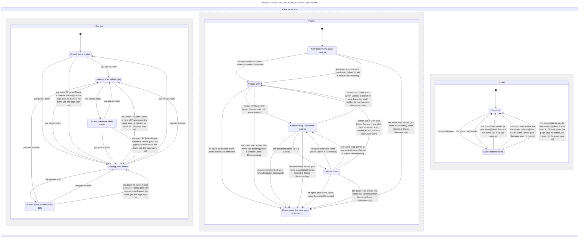

# viewer: the canvas, one frame, while an agent works

The chart follows one frame on an open canvas. Three parts move at the same time. The camera holds the gesture (at rest or moving) and the frame's place from the view: in view at 30% or more, in view under 30%, or far, where its shell leaves the render tree. The frame is not made yet, picture only, picture on top while its document loads, live document, or gone. The third part is the socket. An agent adds the frame, writes it once and deletes it, and the tab shows each step without a reload. While the tab draws no frame, the page says the canvas has no frames yet. Fit moves the camera so the frame is in view and its shell shows. A frame goes live only at rest, and its picture stays on top until the paint script the viewer added to its document posts that it painted. The one change to the live set allowed mid-move is an agent's delete; a frame an agent adds mid-move goes live at the next rest. While the socket is down the page says `Reconnecting`; when it is back, the page reads the whole board, and only then does the status go. The model is [models/viewer/ViewerCanvas.tla](models/viewer/ViewerCanvas.tla) with [ViewerCanvas.cfg](models/viewer/ViewerCanvas.cfg). TLC checks every rule below on all 449 of its states, and each one holds.



| Rule                     | In plain words                                                                                                                                                 | Spec line                                                                             |
| ------------------------ | -------------------------------------------------------------------------------------------------------------------------------------------------------------- | ------------------------------------------------------------------------------------- |
| `TypeOK`                 | Each value is one the tab or the server can hold.                                                                                                              | (model)                                                                               |
| `LiveSetOnlyAtRest`      | During a move, the set of live frames changes only when an agent deletes a frame. By construction (judged in code).                                            | SPEC-viewer.md § Pan and zoom, step 3; judged rule 2                                  |
| `NoBlankBox`             | A document is on top only once it has painted, or 1.5 s passed (one step in the model); until then its picture is. A new version puts the picture back on top. | SPEC-viewer.md § See the frames, step 2; § Watch an agent work, step 1; judged rule 3 |
| `ShowsLatest`            | A connected tab shows the frame as the agent last left it.                                                                                                     | SPEC-viewer.md § Watch an agent work                                                  |
| `BehindSaysReconnecting` | While the tab may be behind, the status says `Reconnecting`, until the full board read is in.                                                                  | SPEC-viewer.md § Lose the socket; judged rule 5                                       |
| `GoneIsNotLive`          | A deleted frame is never live; it goes along with its pins.                                                                                                    | SPEC-viewer.md § Watch an agent work, step 3                                          |
| `LiveIsDrawn`            | Only a frame the tab draws is live: one it has not heard of yet, or one deleted, never is.                                                                     | SPEC-viewer.md § See the frames, step 2; § Watch an agent work, step 3                |
| `InViewShows`            | A frame in view always shows its shell, at any zoom, moving or at rest.                                                                                        | SPEC-viewer.md § Pan and zoom; docs/canvas-speed.md (far shells)                      |
| `FarIsHidden`            | A far frame's shell is out of the render tree, in the same write that moves the camera.                                                                        | SPEC-viewer.md § Pan and zoom; docs/canvas-speed.md (far shells)                      |
| `FitShowsEveryFrame`     | After Fit, until the next pan, zoom or new frame, the frame is in view and its shell shows.                                                                    | SPEC-viewer.md § Pan and zoom                                                         |
| `EmptySaysSo`            | The page says the canvas has no frames yet exactly when it draws none: before the first add, and after the delete.                                             | SPEC-viewer.md § See the frames                                                       |
| `NoDeadlock`             | There is always a next step.                                                                                                                                   | (model)                                                                               |

## What the model leaves out

- Many frames, the order they go live in (nearest first, one per animation frame), and the cap of 12 live documents. tests/browser/viewer-canvas.test.tsx checks the cap on 200 frames.
- Zoom levels and the margins of SPEC-viewer.md § Numbers: "in view" and "far" are two places from the view. The band between them, where a shell that showed keeps showing while the camera moves (hysteresis), is left out. The browser test "the margins" in `tests/browser/viewer-canvas.test.tsx` checks it: live within 0.1 of a view, live kept to 0.5, a shell shown within 0.5 and hidden at rest past 0.75.
- Fit on many frames: here Fit brings the one frame into view. That every frame is in view after Fit is checked in code on 200 frames.
- Time: "the document paints (or 1.5 s pass)" is one step. So `NoBlankBox` checks the order of steps, not the timer: a document that has not painted at 1.5 s goes on top anyway, and the screencast in SPEC-viewer.md's success criteria is what will measure white (deferred: until it is built, the browser tests check that a picture stays on top until its document paints, also when a frame goes live again). Rest (120 ms with no move) is one step too.
- The first read: the model starts with the board read once, so `empty` starts true and stays as it is while the socket is down. Before any read has arrived the page says nothing of the frames, even while `Reconnecting`; a browser test checks that case.
- Atomicity: an agent's write or delete reaches a tab with a live socket in one step with the write on the server. The code pushes the board change after the write commits; a tab between the two is behind for that moment, which the model does not show.
- `LiveSetOnlyAtRest` holds by construction: the model lets only the delete change the live set mid-move, and no variant breaks it. The code is judged against it (judged rule 2).
- A sharper picture replacing a blurred one, and the decode of a new picture. Until pictures are built, the picture is a plain card with the frame's name.
- An agent moving a frame, and more than one write: one add, one write (v1 to v2) and one delete.
- The link: it stays live here. Its end is in [viewer-gate](viewer-gate.md) and [viewer-pin-link](viewer-pin-link.md).

## Steps the chart hides

- The view hides no step.
- Steps that stay in one chart state are not drawn: "the socket is back" (the status still says `Reconnecting` until the read arrives), an add, a write or a delete while the socket is down (the tab does not see it yet), a write to a frame that shows its picture only (its picture changes, its label does not), and a pan during a move that keeps the shell as it was.
- The camera's place for a frame not made yet, or deleted: the camera moves anyway, so the place is where the frame's box would be. `InViewShows` and `FarIsHidden` speak only of a frame the tab draws.

## Make it again

```sh
scripts/statecharts.sh viewer-canvas          # rewrite this page's mermaid block in place if it differs
scripts/statecharts.sh --check viewer-canvas  # change nothing; compare the block and the verdict in charts.tsv
```
