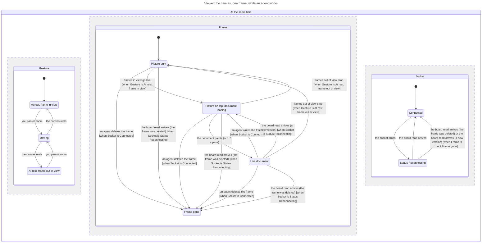

# viewer: the canvas, one frame, while an agent works

The chart follows one frame on an open canvas. Three parts move at the same time: the gesture (at rest or moving), the frame (picture only, picture on top while its document loads, live document, or gone), and the socket. A frame goes live only at rest, and its picture stays on top until the paint script the viewer added to its document posts that it painted. The one change to the live set allowed mid-move is an agent's delete. While the socket is down the page says `Reconnecting`; when it is back, the page reads the whole board, and only then does the status go. The model is [models/viewer/ViewerCanvas.tla](models/viewer/ViewerCanvas.tla) with [ViewerCanvas.cfg](models/viewer/ViewerCanvas.cfg). TLC checks every rule below on all 158 of its states, and each one holds.



| Rule                     | In plain words                                                                                                                                                 | Spec line                                                                             |
| ------------------------ | -------------------------------------------------------------------------------------------------------------------------------------------------------------- | ------------------------------------------------------------------------------------- |
| `TypeOK`                 | Each value is one the tab or the server can hold.                                                                                                              | (model)                                                                               |
| `LiveSetOnlyAtRest`      | During a move, the set of live frames changes only when an agent deletes a frame. By construction (judged in code).                                            | SPEC-viewer.md § Pan and zoom, step 3; judged rule 2                                  |
| `NoBlankBox`             | A document is on top only once it has painted, or 1.5 s passed (one step in the model); until then its picture is. A new version puts the picture back on top. | SPEC-viewer.md § See the frames, step 2; § Watch an agent work, step 1; judged rule 3 |
| `ShowsLatest`            | A connected tab shows the frame as the agent last left it.                                                                                                     | SPEC-viewer.md § Watch an agent work                                                  |
| `BehindSaysReconnecting` | While the tab may be behind, the status says `Reconnecting`, until the full board read is in.                                                                  | SPEC-viewer.md § Lose the socket; judged rule 5                                       |
| `GoneIsNotLive`          | A deleted frame is never live; it goes along with its pins.                                                                                                    | SPEC-viewer.md § Watch an agent work, step 3                                          |
| `NoDeadlock`             | There is always a next step.                                                                                                                                   | (model)                                                                               |

## What the model leaves out

- Many frames, the order they go live in (nearest first, one at a time), and the cap of 12 live documents.
- Zoom levels, the 30% reading zoom, and the hysteresis margins of `docs/canvas-speed.md`: "in view" is one yes or no, decided when the canvas rests.
- Time: "the document paints (or 1.5 s pass)" is one step. So `NoBlankBox` checks the order of steps, not the timer: a document that has not painted at 1.5 s goes on top anyway, and the screencast in SPEC-viewer.md's success criteria is what measures white.
- Atomicity: an agent's write or delete reaches a tab with a live socket in one step with the write on the server. The code pushes the board change after the write commits; a tab between the two is behind for that moment, which the model does not show.
- `LiveSetOnlyAtRest` holds by construction: the model lets only the delete change the live set mid-move, and no variant breaks it. The code is judged against it (judged rule 2).
- A sharper picture replacing a blurred one, and the decode of a new picture.
- An agent moving or adding a frame, and more than one write: one write (v1 to v2) and one delete.
- The link: it stays live here. Its end is in [viewer-gate](viewer-gate.md) and [viewer-pin-link](viewer-pin-link.md).

## Steps the chart hides

- The view hides no step.
- Steps that stay in one chart state are not drawn: "the socket is back" (the status still says `Reconnecting` until the read arrives), a write or a delete while the socket is down (the tab does not see it yet), and a write to a frame that shows its picture only (its picture changes, its label does not).

## Make it again

```sh
scripts/statecharts.sh viewer-canvas          # rewrite this page's mermaid block in place if it differs
scripts/statecharts.sh --check viewer-canvas  # change nothing; compare the block and the verdict in charts.tsv
```
