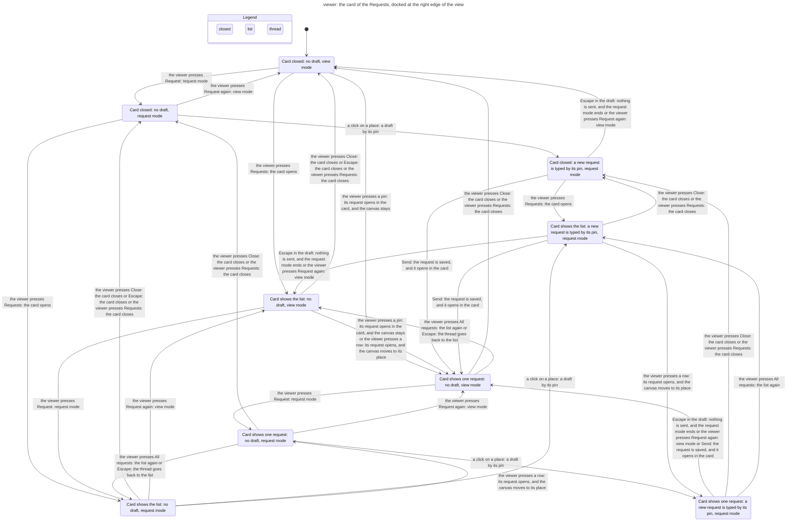

# viewer: the card of the Requests, docked at the right edge of the view

The chart follows the card of the Requests in one tab (SPEC-viewer.md § Follow the requests; docs/epics.md E4.4, decided on 2026-11-23). The card is docked at the right edge of the view, over the canvas. It shows the list of the requests, or one request with its thread. It does not move when the canvas pans, and the canvas does not move when the card opens or changes. A press on a pin opens its request in the card. A press on a row opens its request and moves the canvas to its place. All requests goes back to the list, Close closes the card, and Escape closes the top: the thread goes back to the list, and the list goes. A new request is typed in a draft by its pin, not in the card: Send saves it and opens it in the card. The model is [models/viewer/ViewerCard.tla](models/viewer/ViewerCard.tla) with [ViewerCard.cfg](models/viewer/ViewerCard.cfg).

## The rules

- **AThreadHasItsRequest**: the card shows a thread only with its request, and that request is saved.
- **ADraftIsInRequestMode**: a new request is typed only in the request mode.
- **APanLeavesTheCard**: a pan or a zoom moves only the canvas: the card and its request stay.
- **OnlyARowOrAPanMovesTheCanvas**: the canvas moves only for a pan or a press on a row. A press on a pin, Requests, All requests, Close, Escape and Send never move it.

## What the model leaves out

- The state of each request (waiting, a question, a result): [viewer-queue](viewer-queue.md).
- A link that ends or a frame that goes while a draft is typed: [viewer-pin-link](viewer-pin-link.md).
- The text and the sending of a request: [viewer-pin-post](viewer-pin-post.md).
