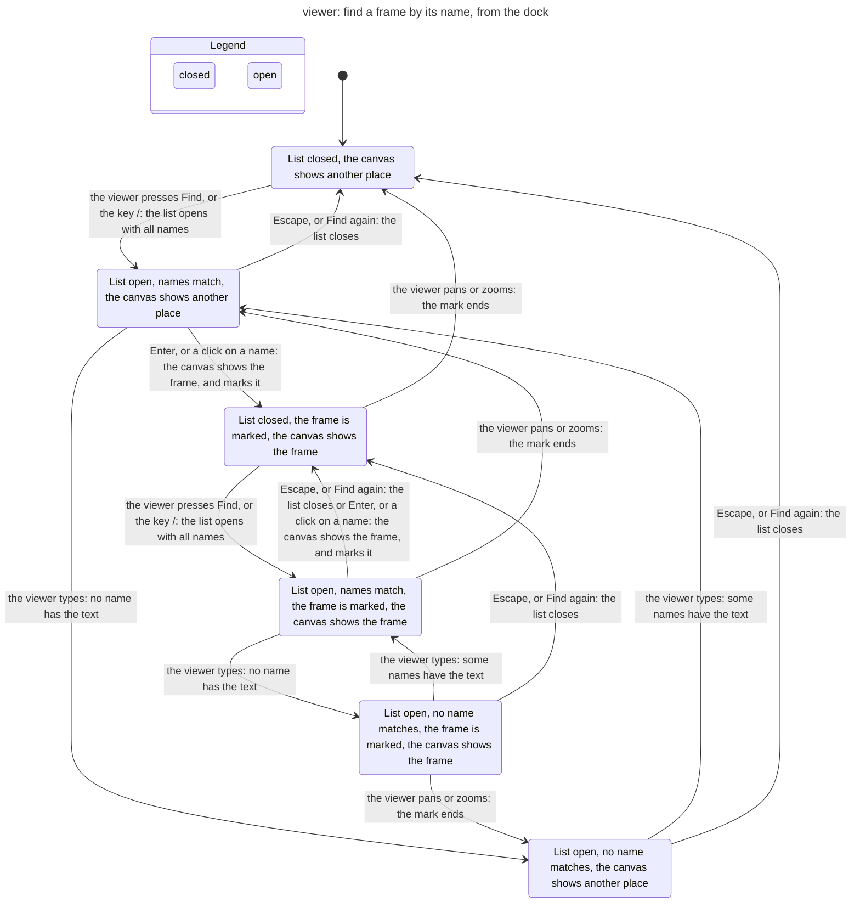

# viewer: find a frame by its name, from the dock

The chart follows Find in one tab (SPEC-viewer.md § Find a frame; docs/epics.md E3 S15, option A, decided on 2026-11-23). The button `Find` in the dock, or the key `/`, opens a list of frame names over the dock, as Miro and Excalidraw do. The viewer types a part of a name, and the list shows the names that have it. Enter or a click takes the selected name: the list closes, the canvas shows that frame, and the frame is marked. Escape or `Find` closes the list with no change. A pan or a zoom ends the mark. The model is [models/viewer/FindFrame.tla](models/viewer/FindFrame.tla) with [FindFrame.cfg](models/viewer/FindFrame.cfg).

## The rules

- **AMarkIsInView**: a frame is marked only while the canvas shows it.
- **ATakeNeedsAName**: the list takes a name only when the typed text matches one.
- **OnlyATakeOrAPanMovesTheCanvas**: the canvas moves only for a take or a pan. Opening the list, typing and closing it never move it.

## What the model leaves out

- Which names match, and their order: the page tests prove it (SPEC-viewer.md § Find a frame).
- A frame that an agent adds or removes while the list is open: the list reads the board each time.
