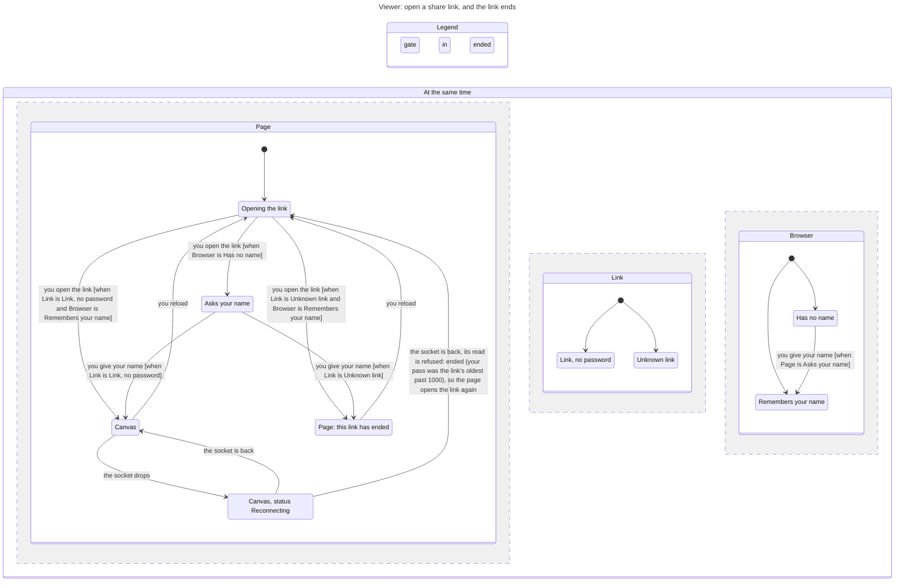

# viewer: open a share link with no password (the first slice)

The same tab as [viewer-gate](viewer-gate.md), as the first slice builds it: every link opens
without a password, and nothing ends a link yet. The page asks for the viewer's name once per
browser, then `share.open` answers `open` with a pass, or `gone` for an unknown link, and the
page says it has ended. The canvas is a placeholder that lists its frames' names from the live
board, with no control. A dropped socket shows "Reconnecting"; the pass is kept as its digest in
SQLite, so it reads again after a restart (decision C8). A link keeps at most 1000 passes: an
open past that ends the link's oldest pass. That tab learns it when its read starts again, on a
reconnect, is refused `{ ended: true }`, and opens the link once more, so it never shows the
ended page for a live link.

The model is [models/viewer/ViewerGate.tla](models/viewer/ViewerGate.tla) with
[ViewerGateOpen.cfg](models/viewer/ViewerGateOpen.cfg): `PasswordLinks = FALSE`,
`Unsharing = FALSE` and `CanvasControls = {}`. [ViewerGate.cfg](models/viewer/ViewerGate.cfg)
runs the same model with passwords, unshare and the canvas's controls. TLC checks every rule below
on all 14 states of this slice, and each one holds. A rule that no step of the slice reaches holds
with nothing to check: its plain words say what brings it into reach.



| Rule                             | In plain words                                                                                                                                    | Spec line                                                                             |
| -------------------------------- | ------------------------------------------------------------------------------------------------------------------------------------------------- | ------------------------------------------------------------------------------------- |
| `TypeOK`                         | Each value is one the tab or the server can hold.                                                                                                 | (model)                                                                               |
| `NoFrameControl`                 | No page of the gate or the canvas shows a control that changes a frame: the placeholder canvas has none at all. By construction (judged in code). | SPEC-viewer.md § Objective                                                            |
| `EndedPageOnly`                  | An unknown link shows a page that says it has ended, and no control. By construction (judged in code).                                            | SPEC-viewer.md § When the link ends; § Contract                                       |
| `WaitMeansWait`                  | Unreached until passwords: no page says to wait.                                                                                                  | SPEC-viewer.md § Open the link, step 2 (the gate: SPEC-frames.md § Open a share link) |
| `NameOnce`                       | The page asks for the name only in a browser that has not given it.                                                                               | SPEC-viewer.md § Open the link, step 1                                                |
| `NameBeforeOpen`                 | No tab gets past the gate without a name: `share.open` takes it.                                                                                  | SPEC-viewer.md § Open the link, step 1; § Contract                                    |
| `EndPushedAtOnce`                | Unreached until `easel unshare` or `easel canvas rm`: no link ends in this slice.                                                                 | SPEC-viewer.md § When the link ends, step 1; § Contract                               |
| `EndedStaysEnded`                | Once a tab is told its link ended, it never shows the canvas or a gate again, until you reload.                                                   | SPEC-viewer.md § When the link ends, step 2                                           |
| `LockPushedAtOnce`               | Unreached until passwords: no password ends a pass. A pass trimmed past 1000 is not pushed; the tab finds out on its next read.                   | SPEC-viewer.md "When a password is set", contract                                     |
| `EndedOnlyWhenGone`              | The ended page shows only for a link that is gone: a tab whose pass was trimmed past 1000 opens the live link again.                              | SPEC-frames.md § Inputs (the 1000-pass cap)                                           |
| `OpenWithoutPasswordIsNeverSlow` | Unreached until passwords: no link asks one.                                                                                                      | SPEC-viewer.md § Open the link, step 2 (the gate: SPEC-frames.md § Open a share link) |
| `NoDeadlock`                     | There is always a next step.                                                                                                                      | (model)                                                                               |

## What the model leaves out

- Everything [viewer-gate](viewer-gate.md) leaves out.
- A path under `/s/` that is not a link's shape: the page shows that it has ended without a call,
  as an unknown link does.
- A pass that `mayRead` turns away while the link is live and the new one is turned away too:
  the page asks once more, then shows the ended page, so a bug on the server cannot loop it.
  tests/browser/viewer-gate.test.tsx checks it.
- When the trim happens: the model trims only a pass the tab holds on the canvas, and lets the
  refusal come on the next reconnect. A read that starts another way (a reload) gets a new pass
  first.
- The flood limit (SPEC-frames judged rule 14): past 30 opens a minute from one address,
  `share.open` answers `slow`. The page stays on Opening and calls again after `retryIn`. That is
  a stutter in "Opening the link", never the wait page, so `OpenWithoutPasswordIsNeverSlow` holds
  as stated. tests/browser/viewer-gate.test.tsx checks the retry.

## Steps the chart hides

- "you reload" from "Asks your name" and from "Canvas, status Reconnecting", as in
  [viewer-gate](viewer-gate.md).
- The server trimming the tab's pass: it shows nothing until the socket is back.

## Make it again

```sh
scripts/statecharts.sh viewer-gate-open          # rewrite this page's mermaid block in place if it differs
scripts/statecharts.sh --check viewer-gate-open  # change nothing; compare the block and the verdict in charts.tsv
```
