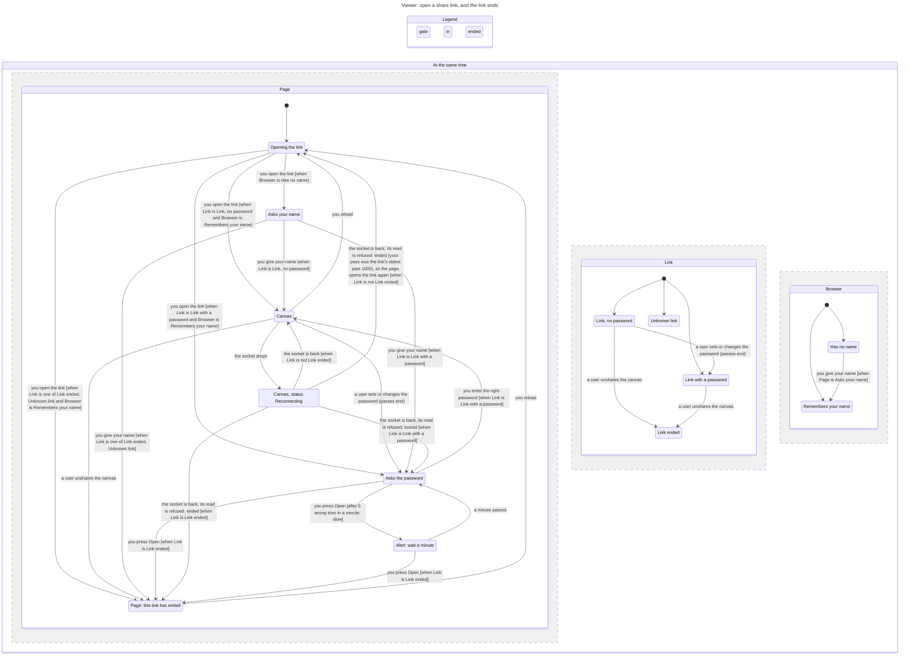

# viewer: open a share link, with passwords and unshare

The same tab as [viewer-gate](viewer-gate.md), as the share-passwords ship builds it: a link may
ask a password, and `easel unshare` ends a link. The canvas has the three controls that have
shipped, Zoom in, Zoom out and Fit; requests are not built, so this chart leaves out the Request
button and the Requests region that [viewer-gate](viewer-gate.md) lists. Every other step is the
full chart's. The model is [models/viewer/ViewerGate.tla](models/viewer/ViewerGate.tla) with
[ViewerGatePassword.cfg](models/viewer/ViewerGatePassword.cfg). TLC checks every rule below on
all 94 of its states, and each one holds.



## Rules

| Rule                             | In plain words                                                                                                                                           | Spec line                                                                             |
| -------------------------------- | -------------------------------------------------------------------------------------------------------------------------------------------------------- | ------------------------------------------------------------------------------------- |
| `TypeOK`                         | Each value is one the tab or the server can hold.                                                                                                        | (model)                                                                               |
| `NoFrameControl`                 | No page of the gate or the canvas shows a control that changes a frame: the canvas has only Zoom in, Zoom out and Fit. By construction (judged in code). | SPEC-viewer.md § Objective                                                            |
| `EndedPageOnly`                  | An ended or unknown link shows a page that says so, and no control. By construction (judged in code).                                                    | SPEC-viewer.md § When the link ends; § Contract                                       |
| `WaitMeansWait`                  | While the page says to wait, even the right password does not open the canvas.                                                                           | SPEC-viewer.md § Open the link, step 2 (the gate: SPEC-frames.md § Open a share link) |
| `NameOnce`                       | The page asks for the name only in a browser that has not given it.                                                                                      | SPEC-viewer.md § Open the link, step 1                                                |
| `NameBeforeOpen`                 | No tab gets past the gate without a name: `share.open` takes it.                                                                                         | SPEC-viewer.md § Open the link, step 1; § Contract                                    |
| `EndPushedAtOnce`                | A tab with a live socket shows the ended page as soon as the link ends.                                                                                  | SPEC-viewer.md § When the link ends, step 1; § Contract                               |
| `EndedStaysEnded`                | Once a tab is told its link ended, it never shows the canvas or a gate again.                                                                            | SPEC-viewer.md § When the link ends, step 2                                           |
| `LockPushedAtOnce`               | A tab with a live socket goes back to the password page as soon as a password set or changed ends its pass.                                              | SPEC-viewer.md "When a password is set", contract                                     |
| `EndedOnlyWhenGone`              | The ended page shows only for a link that is gone: a tab whose pass was trimmed past 1000 opens the live link again.                                     | SPEC-frames.md § Inputs (the 1000-pass cap)                                           |
| `OpenWithoutPasswordIsNeverSlow` | Opening a password link with no password shows the password page, never the alert to wait.                                                               | SPEC-viewer.md § Open the link, step 2 (the gate: SPEC-frames.md § Open a share link) |
| `NoDeadlock`                     | There is always a next step.                                                                                                                             | (model)                                                                               |

## What the model leaves out

- Everything [viewer-gate](viewer-gate.md) leaves out, and the requests, until they ship.
- A pass that `mayRead` turns away while the link is live and the new one is turned away too:
  the page asks once more, then shows the ended page, so a bug on the server cannot loop it.
  tests/browser/viewer-gate.test.tsx checks it.
- The flood limit (SPEC-frames judged rule 14): past 30 opens a minute from one address,
  `share.open` answers `slow`. On "Opening the link" the page stays there and calls again after
  `retryIn`, never the wait page, so `OpenWithoutPasswordIsNeverSlow` holds as stated. A password
  try past the flood limit says to wait, as a try past 5 wrong ones does.
- While the page says to wait, Open still calls: the server answers `slow` until the minute has
  passed, or `gone` once the link has ended ("you press Open" from "Alert: wait a minute").

## Steps the chart hides

- The steps [viewer-gate](viewer-gate.md) hides.

## Make it again

```sh
scripts/statecharts.sh viewer-gate-password          # rewrite this page's mermaid block in place if it differs
scripts/statecharts.sh --check viewer-gate-password  # change nothing; compare the block and the verdict in charts.tsv
```
