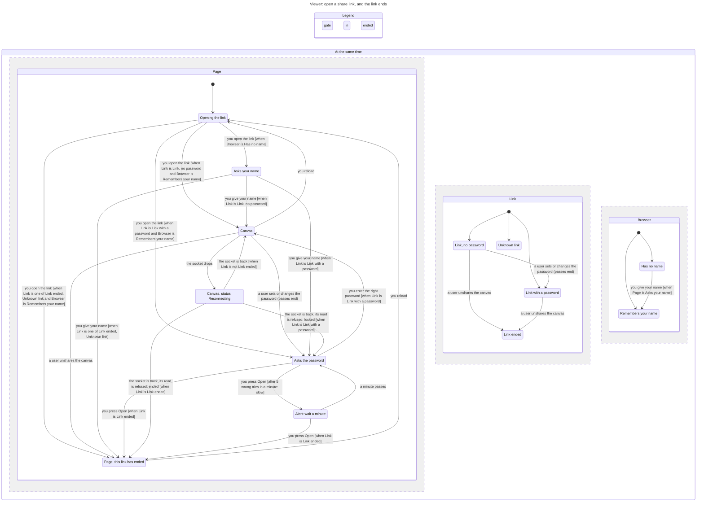

# viewer: open a share link, and the link ends

The chart shows a tab from the moment it opens a share link until it shows the canvas or the ended page. `share.open` takes the viewer's name, so the page asks for it first, once per browser. A password link always asks for the password first: opening it never answers `slow`. Within a minute, password tries 1 to 5 that are wrong answer `wrong`, and any try after 5 wrong ones answers `slow`, even the right password. When a user unshares the canvas, the server pushes the refusal `{ ended: true }` to each tab on the link with a live socket. When a user sets or changes the password, every pass ends, and the server pushes `{ locked: true }`: the tab goes back to the password page. A tab whose socket was down learns either from its read when the socket is back. The model is [models/viewer/ViewerGate.tla](models/viewer/ViewerGate.tla) with [ViewerGate.cfg](models/viewer/ViewerGate.cfg). TLC checks every rule below on all 53 of its states, and each one holds.



| Rule                             | In plain words                                                                                              | Spec line                                                                             |
| -------------------------------- | ----------------------------------------------------------------------------------------------------------- | ------------------------------------------------------------------------------------- |
| `TypeOK`                         | Each value is one the tab or the server can hold.                                                           | (model)                                                                               |
| `NoFrameControl`                 | No page of the gate or the canvas shows a control that changes a frame. By construction (judged in code).   | SPEC-viewer.md § Objective                                                            |
| `EndedPageOnly`                  | An ended or unknown link shows a page that says so, and no control. By construction (judged in code).       | SPEC-viewer.md § When the link ends; § Contract                                       |
| `WaitMeansWait`                  | While the page says to wait, even the right password does not open the canvas.                              | SPEC-viewer.md § Open the link, step 2 (the gate: SPEC-frames.md § Open a share link) |
| `NameOnce`                       | The page asks for the name only in a browser that has not given it.                                         | SPEC-viewer.md § Open the link, step 1                                                |
| `NameBeforeOpen`                 | No tab gets past the gate without a name: `share.open` takes it.                                            | SPEC-viewer.md § Open the link, step 1; § Contract                                    |
| `EndPushedAtOnce`                | A tab with a live socket shows the ended page as soon as the link ends.                                     | SPEC-viewer.md § When the link ends, step 1; § Contract                               |
| `EndedStaysEnded`                | Once a tab is told its link ended, it never shows the canvas or a gate again.                               | SPEC-viewer.md § When the link ends, step 2                                           |
| `LockPushedAtOnce`               | A tab with a live socket goes back to the password page as soon as a password set or changed ends its pass. | SPEC-viewer.md "When a password is set", contract                                     |
| `OpenWithoutPasswordIsNeverSlow` | Opening a password link with no password shows the password page, never the alert to wait.                  | SPEC-viewer.md § Open the link, step 2 (the gate: SPEC-frames.md § Open a share link) |
| `NoDeadlock`                     | There is always a next step.                                                                                | (model)                                                                               |

## What the model leaves out

- The text the page shows on each page, and the `alert` text.
- Time, except as "a minute passes": the lockout is 2 wrong tries in the model, 5 in the spec.
- Many tabs: the model has one tab. Each tab on the link acts the same.
- Removing the password, which ends no pass: the tab stays as it is.
- Atomicity: the server's push of `{ ended: true }` or `{ locked: true }` to a tab with a live socket is one step with the write that ends the link or the pass. The code must push in the same request, before it answers.
- `NoFrameControl` and `EndedPageOnly` hold by construction: the model lists each page's controls, and no variant breaks them. The code is judged against them.
- A link shared again after it ended: it is a new link, so a new run of this chart.
- The canvas itself: [viewer-canvas](viewer-canvas.md), [viewer-pin-post](viewer-pin-post.md), [viewer-pin-link](viewer-pin-link.md) and [viewer-queue](viewer-queue.md).

## Steps the chart hides

- "you reload" from a gate page and from "Canvas, status Reconnecting". Each goes back to "Opening the link", which the reload from the canvas and the ended page already shows.
- Steps that stay in one chart state are not drawn: a wrong try 1 to 5 in a minute (it answers `wrong`; the `alert` shows on "Asks the password"), a password set or changed while the tab is not on the connected canvas, and a minute passing on a page that is not waiting.

## Make it again

```sh
scripts/statecharts.sh viewer-gate          # rewrite this page's mermaid block in place if it differs
scripts/statecharts.sh --check viewer-gate  # change nothing; compare the block and the verdict in charts.tsv
```
