# viewer: the outline of the part under the pointer, in the request mode

The chart follows the hover outline in one tab (SPEC-viewer.md § Ask for a change 1; request #10, 2026-11-23). In the request mode, the part of a live frame under the pointer gets an outline before a click, as the comment modes of Figma and Vercel do. The page asks the paint script in the frame for the box of the element under the pointer, at most once in each animation frame. Only the answer to the last ask shows. The outline goes when the pointer leaves the frames, when a draft opens, and out of the request mode. The model is [models/viewer/PartHover.tla](models/viewer/PartHover.tla) with [PartHover.cfg](models/viewer/PartHover.cfg).

```mermaid
---
title: "viewer: the outline of the part under the pointer, in the request mode"
---
stateDiagram-v2
  state "Legend" as legend {
    lg0: view
    lg1: request
    lg2: draft
  }
  class lg0 tan
  class lg1 teal
  class lg2 blue
  s0: View mode, pointer on no part, no outline
  s1: Request mode, pointer on no part, no outline
  s2: View mode, pointer on part 1, no outline
  s3: View mode, pointer on part 2, no outline
  s4: Request mode, pointer on part 1, no outline
  s5: Request mode, pointer on part 1, no outline, 1 answer on the way
  s6: Request mode, pointer on part 2, no outline
  s7: Request mode, pointer on part 2, no outline, 1 answer on the way
  s8: Request mode, pointer on no part, no outline, 1 answer on the way
  s9: Request mode, pointer on part 1, no outline, 2 answers on the way
  s10: View mode, pointer on part 1, no outline, 1 answer on the way
  s11: Request mode, pointer on part 1, outline on part 1
  s12: Request mode, pointer on part 2, no outline, 2 answers on the way
  s13: View mode, pointer on part 2, no outline, 1 answer on the way
  s14: Request mode, pointer on part 2, outline on part 2
  s15: A draft is typed, pointer on part 1, no outline, 1 answer on the way
  s16: A draft is typed, pointer on part 1, no outline
  s17: A draft is typed, pointer on part 2, no outline, 1 answer on the way
  s18: A draft is typed, pointer on part 2, no outline
  s19: Request mode, pointer on no part, no outline, 2 answers on the way
  s20: View mode, pointer on no part, no outline, 1 answer on the way
  s21: View mode, pointer on part 1, no outline, 2 answers on the way
  s22: Request mode, pointer on part 1, outline on part 1, 1 answer on the way
  s23: Request mode, pointer on part 1, outline on part 2, 1 answer on the way
  s24: View mode, pointer on part 2, no outline, 2 answers on the way
  s25: Request mode, pointer on part 2, outline on part 1, 1 answer on the way
  s26: Request mode, pointer on part 2, outline on part 2, 1 answer on the way
  s27: A draft is typed, pointer on no part, no outline, 1 answer on the way
  s28: A draft is typed, pointer on no part, no outline
  s29: A draft is typed, pointer on part 1, no outline, 2 answers on the way
  s30: A draft is typed, pointer on part 2, no outline, 2 answers on the way
  s31: View mode, pointer on no part, no outline, 2 answers on the way
  s32: Request mode, pointer on part 1, outline on part 1, 2 answers on the way
  s33: Request mode, pointer on part 2, outline on part 2, 2 answers on the way
  s34: A draft is typed, pointer on no part, no outline, 2 answers on the way
  [*] --> s0
  s0 --> s1: the viewer presses Request: request mode
  s0 --> s2: the pointer moves onto part 1
  s0 --> s3: the pointer moves onto part 2
  s1 --> s0: the viewer presses Request again: view mode
  s1 --> s5: the pointer moves onto part 1
  s1 --> s7: the pointer moves onto part 2
  s2 --> s0: the pointer leaves the frames: the outline goes
  s2 --> s4: the viewer presses Request: request mode
  s2 --> s3: the pointer moves onto part 2
  s3 --> s0: the pointer leaves the frames: the outline goes
  s3 --> s2: the pointer moves onto part 1
  s3 --> s6: the viewer presses Request: request mode
  s4 --> s2: the viewer presses Request again: view mode
  s4 --> s1: the pointer leaves the frames: the outline goes
  s4 --> s7: the pointer moves onto part 2
  s4 --> s16: a click on the part: a draft opens, and the hover outline goes
  s5 --> s8: the pointer leaves the frames: the outline goes
  s5 --> s10: the viewer presses Request again: view mode
  s5 --> s11: the answer comes: the outline shows on part 1
  s5 --> s12: the pointer moves onto part 2
  s5 --> s15: a click on the part: a draft opens, and the hover outline goes
  s6 --> s3: the viewer presses Request again: view mode
  s6 --> s1: the pointer leaves the frames: the outline goes
  s6 --> s5: the pointer moves onto part 1
  s6 --> s18: a click on the part: a draft opens, and the hover outline goes
  s7 --> s8: the pointer leaves the frames: the outline goes
  s7 --> s9: the pointer moves onto part 1
  s7 --> s13: the viewer presses Request again: view mode
  s7 --> s14: the answer comes: the outline shows on part 2
  s7 --> s17: a click on the part: a draft opens, and the hover outline goes
  s8 --> s1: a late answer comes: nothing shows
  s8 --> s5: the pointer moves onto part 1
  s8 --> s12: the pointer moves onto part 2
  s8 --> s20: the viewer presses Request again: view mode
  s8 --> s9: the pointer moves onto part 1
  s8 --> s7: the pointer moves onto part 2
  s9 --> s5: a late answer comes: nothing shows
  s9 --> s19: the pointer leaves the frames: the outline goes
  s9 --> s21: the viewer presses Request again: view mode
  s9 --> s22: the answer comes: the outline shows on part 1
  s9 --> s12: the pointer moves onto part 2
  s9 --> s29: a click on the part: a draft opens, and the hover outline goes
  s10 --> s2: a late answer comes: nothing shows
  s10 --> s20: the pointer leaves the frames: the outline goes
  s10 --> s5: the viewer presses Request: request mode
  s10 --> s13: the pointer moves onto part 2
  s11 --> s2: the viewer presses Request again: view mode
  s11 --> s1: the pointer leaves the frames: the outline goes
  s11 --> s16: a click on the part: a draft opens, and the hover outline goes
  s11 --> s25: the pointer moves onto part 2
  s12 --> s7: a late answer comes: nothing shows
  s12 --> s19: the pointer leaves the frames: the outline goes
  s12 --> s9: the pointer moves onto part 1
  s12 --> s24: the viewer presses Request again: view mode
  s12 --> s26: the answer comes: the outline shows on part 2
  s12 --> s30: a click on the part: a draft opens, and the hover outline goes
  s13 --> s3: a late answer comes: nothing shows
  s13 --> s20: the pointer leaves the frames: the outline goes
  s13 --> s10: the pointer moves onto part 1
  s13 --> s7: the viewer presses Request: request mode
  s14 --> s3: the viewer presses Request again: view mode
  s14 --> s1: the pointer leaves the frames: the outline goes
  s14 --> s18: a click on the part: a draft opens, and the hover outline goes
  s14 --> s23: the pointer moves onto part 1
  s15 --> s10: Send or Escape: the draft ends
  s15 --> s16: a late answer comes: nothing shows
  s15 --> s27: the pointer leaves the frames: the outline goes
  s15 --> s17: the pointer moves onto part 2
  s16 --> s2: Send or Escape: the draft ends
  s16 --> s28: the pointer leaves the frames: the outline goes
  s16 --> s18: the pointer moves onto part 2
  s17 --> s13: Send or Escape: the draft ends
  s17 --> s18: a late answer comes: nothing shows
  s17 --> s27: the pointer leaves the frames: the outline goes
  s17 --> s15: the pointer moves onto part 1
  s18 --> s3: Send or Escape: the draft ends
  s18 --> s28: the pointer leaves the frames: the outline goes
  s18 --> s16: the pointer moves onto part 1
  s19 --> s8: a late answer comes: nothing shows
  s19 --> s9: the pointer moves onto part 1
  s19 --> s12: the pointer moves onto part 2
  s19 --> s31: the viewer presses Request again: view mode
  s20 --> s0: a late answer comes: nothing shows
  s20 --> s8: the viewer presses Request: request mode
  s20 --> s10: the pointer moves onto part 1
  s20 --> s13: the pointer moves onto part 2
  s5 --> s4: a late answer comes: nothing shows
  s21 --> s10: a late answer comes: nothing shows
  s21 --> s31: the pointer leaves the frames: the outline goes
  s21 --> s9: the viewer presses Request: request mode
  s21 --> s24: the pointer moves onto part 2
  s22 --> s8: the pointer leaves the frames: the outline goes
  s22 --> s10: the viewer presses Request again: view mode
  s22 --> s11: a late answer comes: nothing shows
  s22 --> s15: a click on the part: a draft opens, and the hover outline goes
  s22 --> s25: the pointer moves onto part 2
  s23 --> s8: the pointer leaves the frames: the outline goes
  s23 --> s10: the viewer presses Request again: view mode
  s23 --> s11: the answer comes: the outline shows on part 1
  s23 --> s15: a click on the part: a draft opens, and the hover outline goes
  s23 --> s33: the pointer moves onto part 2
  s7 --> s6: a late answer comes: nothing shows
  s24 --> s13: a late answer comes: nothing shows
  s24 --> s31: the pointer leaves the frames: the outline goes
  s24 --> s21: the pointer moves onto part 1
  s24 --> s12: the viewer presses Request: request mode
  s25 --> s8: the pointer leaves the frames: the outline goes
  s25 --> s13: the viewer presses Request again: view mode
  s25 --> s14: the answer comes: the outline shows on part 2
  s25 --> s17: a click on the part: a draft opens, and the hover outline goes
  s25 --> s32: the pointer moves onto part 1
  s26 --> s8: the pointer leaves the frames: the outline goes
  s26 --> s13: the viewer presses Request again: view mode
  s26 --> s14: a late answer comes: nothing shows
  s26 --> s17: a click on the part: a draft opens, and the hover outline goes
  s26 --> s23: the pointer moves onto part 1
  s27 --> s20: Send or Escape: the draft ends
  s27 --> s28: a late answer comes: nothing shows
  s27 --> s15: the pointer moves onto part 1
  s27 --> s17: the pointer moves onto part 2
  s28 --> s0: Send or Escape: the draft ends
  s28 --> s16: the pointer moves onto part 1
  s28 --> s18: the pointer moves onto part 2
  s29 --> s21: Send or Escape: the draft ends
  s29 --> s15: a late answer comes: nothing shows
  s29 --> s34: the pointer leaves the frames: the outline goes
  s29 --> s30: the pointer moves onto part 2
  s30 --> s24: Send or Escape: the draft ends
  s30 --> s17: a late answer comes: nothing shows
  s30 --> s34: the pointer leaves the frames: the outline goes
  s30 --> s29: the pointer moves onto part 1
  s31 --> s19: the viewer presses Request: request mode
  s31 --> s20: a late answer comes: nothing shows
  s31 --> s21: the pointer moves onto part 1
  s31 --> s24: the pointer moves onto part 2
  s5 --> s7: the pointer moves onto part 2
  s32 --> s19: the pointer leaves the frames: the outline goes
  s32 --> s21: the viewer presses Request again: view mode
  s32 --> s22: a late answer comes: nothing shows
  s32 --> s29: a click on the part: a draft opens, and the hover outline goes
  s7 --> s5: the pointer moves onto part 1
  s33 --> s19: the pointer leaves the frames: the outline goes
  s33 --> s24: the viewer presses Request again: view mode
  s33 --> s26: a late answer comes: nothing shows
  s33 --> s30: a click on the part: a draft opens, and the hover outline goes
  s34 --> s31: Send or Escape: the draft ends
  s34 --> s27: a late answer comes: nothing shows
  s34 --> s29: the pointer moves onto part 1
  s34 --> s30: the pointer moves onto part 2
  class s0 tan
  class s1 teal
  class s2 tan
  class s3 tan
  class s4 teal
  class s5 teal
  class s6 teal
  class s7 teal
  class s8 teal
  class s9 teal
  class s10 tan
  class s11 teal
  class s12 teal
  class s13 tan
  class s14 teal
  class s15 blue
  class s16 blue
  class s17 blue
  class s18 blue
  class s19 teal
  class s20 tan
  class s21 tan
  class s22 teal
  class s23 teal
  class s24 tan
  class s25 teal
  class s26 teal
  class s27 blue
  class s28 blue
  class s29 blue
  class s30 blue
  class s31 tan
  class s32 teal
  class s33 teal
  class s34 blue
```

## The rules

- **AnOutlineOnlyWhileHovering**: an outline shows only in the request mode, with no draft.
- **OnlyTheLastAskShows**: an outline shows only for the part of the last ask. A late answer never shows.

## What the model leaves out

- The outline of the part that a draft is on: [viewer-pin-post](viewer-pin-post.md) and SPEC-viewer.md § Ask for a change 2.
- A frame that is not live: it has no paint script, so it gets no outline.
