# viewer: a person drops or pastes an image on the canvas

The chart follows the canvas of one tab while a person drops or pastes an image on it
(SPEC-arrange.md rules 29 to 34, I3). Only a signed-in member on `/c/<canvas>` can do it: a share
link takes no image. While a file is over the canvas, the canvas shows a hint. A drop goes at the
place of the drop; a paste goes at the pointer, or in the middle of the view. A paste into a text
field, as the textbox of a request (I2), goes to that field. One image goes at a time. A file that
is not an image of at most 10 MiB, an image that the server refuses, and a lost socket make no
frame, and the page says why. The model is
[models/viewer/ImageDrop.tla](models/viewer/ImageDrop.tla) with
[ImageDrop.cfg](models/viewer/ImageDrop.cfg). TLC checks every rule below on all 43 of its states,
and each one holds.

```mermaid
---
title: "viewer: a person drops or pastes an image on the canvas"
---
stateDiagram-v2
  state "Legend" as legend {
    lg0: viewer
    lg1: canvas
    lg2: going
  }
  class lg0 tan
  class lg1 blue
  class lg2 yellow
  s0: The canvas
  s1: A share link: the canvas takes no image
  s2: An image goes at the place of the drop
  s3: The canvas, shows the hint for the drop
  s4: The canvas, says only an image of 10 MB at most goes
  s5: An image goes at the place of the paste
  s6: An image goes at the place of the drop, shows the hint for the drop
  s7: An image goes at the place of the drop, says to wait for the image that goes
  s8: The canvas, says the image did not go
  s9: The canvas, a frame at the place of the drop
  s10: The canvas, a frame at the place of the paste
  s11: The canvas, shows the hint for the drop, says only an image of 10 MB at most goes
  s12: An image goes at the place of the paste, shows the hint for the drop
  s13: An image goes at the place of the paste, says to wait for the image that goes
  s14: An image goes at the place of the drop, a frame at the place of the drop
  s15: An image goes at the place of the drop, a frame at the place of the paste
  s16: An image goes at the place of the drop, shows the hint for the drop, says to wait for the image that goes
  s17: The canvas, shows the hint for the drop, says the image did not go
  s18: The canvas, shows the hint for the drop, a frame at the place of the drop
  s19: The canvas, shows the hint for the drop, a frame at the place of the paste
  s20: The canvas, says only an image of 10 MB at most goes, a frame at the place of the drop
  s21: The canvas, says only an image of 10 MB at most goes, a frame at the place of the paste
  s22: An image goes at the place of the paste, a frame at the place of the drop
  s23: An image goes at the place of the paste, a frame at the place of the paste
  s24: An image goes at the place of the paste, shows the hint for the drop, says to wait for the image that goes
  s25: An image goes at the place of the drop, shows the hint for the drop, a frame at the place of the drop
  s26: An image goes at the place of the drop, shows the hint for the drop, a frame at the place of the paste
  s27: An image goes at the place of the drop, says to wait for the image that goes, a frame at the place of the drop
  s28: An image goes at the place of the drop, says to wait for the image that goes, a frame at the place of the paste
  s29: The canvas, says the image did not go, a frame at the place of the drop
  s30: The canvas, says the image did not go, a frame at the place of the paste
  s31: The canvas, shows the hint for the drop, says only an image of 10 MB at most goes, a frame at the place of the drop
  s32: The canvas, shows the hint for the drop, says only an image of 10 MB at most goes, a frame at the place of the paste
  s33: An image goes at the place of the paste, shows the hint for the drop, a frame at the place of the drop
  s34: An image goes at the place of the paste, shows the hint for the drop, a frame at the place of the paste
  s35: An image goes at the place of the paste, says to wait for the image that goes, a frame at the place of the drop
  s36: An image goes at the place of the paste, says to wait for the image that goes, a frame at the place of the paste
  s37: An image goes at the place of the drop, shows the hint for the drop, says to wait for the image that goes, a frame at the place of the drop
  s38: An image goes at the place of the drop, shows the hint for the drop, says to wait for the image that goes, a frame at the place of the paste
  s39: The canvas, shows the hint for the drop, says the image did not go, a frame at the place of the drop
  s40: The canvas, shows the hint for the drop, says the image did not go, a frame at the place of the paste
  s41: An image goes at the place of the paste, shows the hint for the drop, says to wait for the image that goes, a frame at the place of the drop
  s42: An image goes at the place of the paste, shows the hint for the drop, says to wait for the image that goes, a frame at the place of the paste
  [*] --> s0
  [*] --> s1
  s0 --> s2: a drop of an image
  s0 --> s3: a file comes over the canvas
  s0 --> s4: a drop of another file, or over 10 MB or a paste of another file
  s0 --> s5: a paste of an image on the canvas
  s2 --> s4: put answers badImage or tooBig
  s2 --> s6: a file comes over the canvas
  s2 --> s7: a drop while an image goes or a paste while an image goes
  s2 --> s8: the socket is lost
  s2 --> s9: put answers created
  s3 --> s0: the file goes off the canvas
  s3 --> s2: a drop of an image
  s3 --> s4: a drop of another file, or over 10 MB
  s3 --> s11: a paste of another file
  s3 --> s12: a paste of an image on the canvas
  s4 --> s2: a drop of an image
  s4 --> s5: a paste of an image on the canvas
  s4 --> s11: a file comes over the canvas
  s5 --> s4: put answers badImage or tooBig
  s5 --> s8: the socket is lost
  s5 --> s10: put answers created
  s5 --> s12: a file comes over the canvas
  s5 --> s13: a drop while an image goes or a paste while an image goes
  s6 --> s2: the file goes off the canvas
  s6 --> s7: a drop while an image goes
  s6 --> s11: put answers badImage or tooBig
  s6 --> s16: a paste while an image goes
  s6 --> s17: the socket is lost
  s6 --> s18: put answers created
  s7 --> s4: put answers badImage or tooBig
  s7 --> s8: the socket is lost
  s7 --> s9: put answers created
  s7 --> s16: a file comes over the canvas
  s8 --> s2: a drop of an image
  s8 --> s4: a drop of another file, or over 10 MB or a paste of another file
  s8 --> s5: a paste of an image on the canvas
  s8 --> s17: a file comes over the canvas
  s9 --> s14: a drop of an image
  s9 --> s18: a file comes over the canvas
  s9 --> s20: a drop of another file, or over 10 MB or a paste of another file
  s9 --> s22: a paste of an image on the canvas
  s10 --> s15: a drop of an image
  s10 --> s19: a file comes over the canvas
  s10 --> s21: a drop of another file, or over 10 MB or a paste of another file
  s10 --> s23: a paste of an image on the canvas
  s11 --> s2: a drop of an image
  s11 --> s4: a drop of another file, or over 10 MB or the file goes off the canvas
  s11 --> s12: a paste of an image on the canvas
  s12 --> s5: the file goes off the canvas
  s12 --> s11: put answers badImage or tooBig
  s12 --> s13: a drop while an image goes
  s12 --> s17: the socket is lost
  s12 --> s19: put answers created
  s12 --> s24: a paste while an image goes
  s13 --> s4: put answers badImage or tooBig
  s13 --> s8: the socket is lost
  s13 --> s10: put answers created
  s13 --> s24: a file comes over the canvas
  s14 --> s9: put answers created
  s14 --> s20: put answers badImage or tooBig
  s14 --> s25: a file comes over the canvas
  s14 --> s27: a drop while an image goes or a paste while an image goes
  s14 --> s29: the socket is lost
  s15 --> s9: put answers created
  s15 --> s21: put answers badImage or tooBig
  s15 --> s26: a file comes over the canvas
  s15 --> s28: a drop while an image goes or a paste while an image goes
  s15 --> s30: the socket is lost
  s16 --> s7: a drop while an image goes or the file goes off the canvas
  s16 --> s11: put answers badImage or tooBig
  s16 --> s17: the socket is lost
  s16 --> s18: put answers created
  s17 --> s2: a drop of an image
  s17 --> s4: a drop of another file, or over 10 MB
  s17 --> s8: the file goes off the canvas
  s17 --> s11: a paste of another file
  s17 --> s12: a paste of an image on the canvas
  s18 --> s9: the file goes off the canvas
  s18 --> s14: a drop of an image
  s18 --> s20: a drop of another file, or over 10 MB
  s18 --> s31: a paste of another file
  s18 --> s33: a paste of an image on the canvas
  s19 --> s10: the file goes off the canvas
  s19 --> s15: a drop of an image
  s19 --> s21: a drop of another file, or over 10 MB
  s19 --> s32: a paste of another file
  s19 --> s34: a paste of an image on the canvas
  s20 --> s14: a drop of an image
  s20 --> s22: a paste of an image on the canvas
  s20 --> s31: a file comes over the canvas
  s21 --> s15: a drop of an image
  s21 --> s23: a paste of an image on the canvas
  s21 --> s32: a file comes over the canvas
  s22 --> s10: put answers created
  s22 --> s20: put answers badImage or tooBig
  s22 --> s29: the socket is lost
  s22 --> s33: a file comes over the canvas
  s22 --> s35: a drop while an image goes or a paste while an image goes
  s23 --> s10: put answers created
  s23 --> s21: put answers badImage or tooBig
  s23 --> s30: the socket is lost
  s23 --> s34: a file comes over the canvas
  s23 --> s36: a drop while an image goes or a paste while an image goes
  s24 --> s11: put answers badImage or tooBig
  s24 --> s13: a drop while an image goes or the file goes off the canvas
  s24 --> s17: the socket is lost
  s24 --> s19: put answers created
  s25 --> s14: the file goes off the canvas
  s25 --> s18: put answers created
  s25 --> s27: a drop while an image goes
  s25 --> s31: put answers badImage or tooBig
  s25 --> s37: a paste while an image goes
  s25 --> s39: the socket is lost
  s26 --> s15: the file goes off the canvas
  s26 --> s18: put answers created
  s26 --> s28: a drop while an image goes
  s26 --> s32: put answers badImage or tooBig
  s26 --> s38: a paste while an image goes
  s26 --> s40: the socket is lost
  s27 --> s9: put answers created
  s27 --> s20: put answers badImage or tooBig
  s27 --> s29: the socket is lost
  s27 --> s37: a file comes over the canvas
  s28 --> s9: put answers created
  s28 --> s21: put answers badImage or tooBig
  s28 --> s30: the socket is lost
  s28 --> s38: a file comes over the canvas
  s29 --> s14: a drop of an image
  s29 --> s20: a drop of another file, or over 10 MB or a paste of another file
  s29 --> s22: a paste of an image on the canvas
  s29 --> s39: a file comes over the canvas
  s30 --> s15: a drop of an image
  s30 --> s21: a drop of another file, or over 10 MB or a paste of another file
  s30 --> s23: a paste of an image on the canvas
  s30 --> s40: a file comes over the canvas
  s31 --> s14: a drop of an image
  s31 --> s20: a drop of another file, or over 10 MB or the file goes off the canvas
  s31 --> s33: a paste of an image on the canvas
  s32 --> s15: a drop of an image
  s32 --> s21: a drop of another file, or over 10 MB or the file goes off the canvas
  s32 --> s34: a paste of an image on the canvas
  s33 --> s19: put answers created
  s33 --> s22: the file goes off the canvas
  s33 --> s31: put answers badImage or tooBig
  s33 --> s35: a drop while an image goes
  s33 --> s39: the socket is lost
  s33 --> s41: a paste while an image goes
  s34 --> s19: put answers created
  s34 --> s23: the file goes off the canvas
  s34 --> s32: put answers badImage or tooBig
  s34 --> s36: a drop while an image goes
  s34 --> s40: the socket is lost
  s34 --> s42: a paste while an image goes
  s35 --> s10: put answers created
  s35 --> s20: put answers badImage or tooBig
  s35 --> s29: the socket is lost
  s35 --> s41: a file comes over the canvas
  s36 --> s10: put answers created
  s36 --> s21: put answers badImage or tooBig
  s36 --> s30: the socket is lost
  s36 --> s42: a file comes over the canvas
  s37 --> s18: put answers created
  s37 --> s27: a drop while an image goes or the file goes off the canvas
  s37 --> s31: put answers badImage or tooBig
  s37 --> s39: the socket is lost
  s38 --> s18: put answers created
  s38 --> s28: a drop while an image goes or the file goes off the canvas
  s38 --> s32: put answers badImage or tooBig
  s38 --> s40: the socket is lost
  s39 --> s14: a drop of an image
  s39 --> s20: a drop of another file, or over 10 MB
  s39 --> s29: the file goes off the canvas
  s39 --> s31: a paste of another file
  s39 --> s33: a paste of an image on the canvas
  s40 --> s15: a drop of an image
  s40 --> s21: a drop of another file, or over 10 MB
  s40 --> s30: the file goes off the canvas
  s40 --> s32: a paste of another file
  s40 --> s34: a paste of an image on the canvas
  s41 --> s19: put answers created
  s41 --> s31: put answers badImage or tooBig
  s41 --> s35: a drop while an image goes or the file goes off the canvas
  s41 --> s39: the socket is lost
  s42 --> s19: put answers created
  s42 --> s32: put answers badImage or tooBig
  s42 --> s36: a drop while an image goes or the file goes off the canvas
  s42 --> s40: the socket is lost
  class s0 blue
  class s1 tan
  class s2 yellow
  class s3 blue
  class s4 blue
  class s5 yellow
  class s6 yellow
  class s7 yellow
  class s8 blue
  class s9 blue
  class s10 blue
  class s11 blue
  class s12 yellow
  class s13 yellow
  class s14 yellow
  class s15 yellow
  class s16 yellow
  class s17 blue
  class s18 blue
  class s19 blue
  class s20 blue
  class s21 blue
  class s22 yellow
  class s23 yellow
  class s24 yellow
  class s25 yellow
  class s26 yellow
  class s27 yellow
  class s28 yellow
  class s29 blue
  class s30 blue
  class s31 blue
  class s32 blue
  class s33 yellow
  class s34 yellow
  class s35 yellow
  class s36 yellow
  class s37 yellow
  class s38 yellow
  class s39 blue
  class s40 blue
  class s41 yellow
  class s42 yellow
```

| Rule                     | In plain words                                                            | Spec line                    |
| ------------------------ | ------------------------------------------------------------------------- | ---------------------------- |
| `TypeOK`                 | Each value is one that the tab can hold.                                  | (model)                      |
| `AViewerNeverWrites`     | A viewer of a share link makes no frame, and sees no hint.                | SPEC-arrange.md rule 34      |
| `ATextPasteMakesNoFrame` | A paste into a text field never makes a frame.                            | SPEC-arrange.md rule 30      |
| `OneAtATime`             | A drop or a paste while an image goes does not replace it.                | SPEC-arrange.md rule 31      |
| `TheFrameIsWhereItWent`  | The frame is at the place of its drop or paste.                           | SPEC-arrange.md rules 29, 30 |
| `ARefusalMakesNoFrame`   | A refused file, a refusal of the server, or a lost socket makes no frame. | SPEC-arrange.md rule 32      |
| `NoDeadlock`             | There is always a next step.                                              | (model)                      |

## What the model leaves out

- The bytes, the type and the size of the file: the page and the server check them
  (SPEC-frames § Image frames).
- The place in numbers: a test drops at a point and reads the frame's box.
- The textbox of a request and its screenshot: [viewer-request-shot](viewer-request-shot.md).
