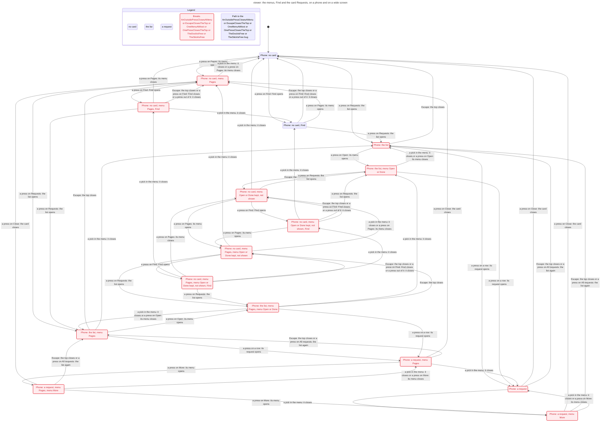

# viewer: the overlays of the page before 2026-11-24, on a phone

This chart has the model of [viewer-overlays](viewer-overlays.md) with
[ViewerOverlaysToday.cfg](models/viewer/ViewerOverlaysToday.cfg) (`Design = "today"`, a phone
only). It is the page that the user reported on 2026-11-24: "The dock, and the mailbox is way too
big on mobile view, and those overlapping each other leading to deadend and have to do refresh to
clean state." Each menu opens and closes only by its own button or a pick, the list has no
`Close`, and on a phone the card covers the dock. TLC finds that `OnePressClosesTheTop` breaks in
1 step:

1. On a phone, a press on `Requests` opens the list. The list covers the dock, so `Requests` is
   under it, and the head of the list has no `Close`. No press closes the list.

The other rules break too: a press out of a menu does not close it, Escape does not close a menu,
and the menus `Pages` and `Open or Done` open together. So the menus are the Menu of Base UI, the
list has `Close`, and on a phone the card stops above the dock (SPEC-viewer.md § The page,
item 5).

