# viewer: the menus, Find and the card Requests, on a phone and on a wide screen

The chart follows what lies over the canvas in one tab (SPEC-viewer.md § The page, item 5; the user's report of 2026-11-24). The dock holds `Requests`, `Find`, `Pages`, `Locale` and `Zoom`. The card `Requests` shows the list or one request. Five menus open from a button: `Pages`, `Locale` and `Zoom` in the dock, the list menu (`Open` or `Done`) in the head of the list, and `More` in the head of a request. The menus are the Menu of Base UI: one menu at a time, and a press out of a menu or Escape closes it. The list has a `Close` button. On a phone (a screen narrower than 640 px) the card stops above the dock, and `Find` closes the card. The model is [models/viewer/ViewerOverlays.tla](models/viewer/ViewerOverlays.tla) with [ViewerOverlays.cfg](models/viewer/ViewerOverlays.cfg).

```mermaid
---
title: "viewer: the menus, Find and the card Requests, on a phone and on a wide screen"
---
stateDiagram-v2
  state "Legend" as legend {
    lg0: no card
    lg1: the list
    lg2: a request
  }
  class lg0 tan
  class lg1 teal
  class lg2 blue
  s0: Phone: no card
  s1: Wide: no card
  s2: Phone: no card, menu Locale
  s3: Wide: no card, menu Locale
  s4: Phone: no card, menu Pages
  s5: Wide: no card, menu Pages
  s6: Phone: no card, menu Zoom
  s7: Wide: no card, menu Zoom
  s8: Phone: no card, Find
  s9: Wide: no card, Find
  s10: Phone: the list
  s11: Wide: the list
  s12: Phone: the list, menu Open or Done
  s13: Wide: the list, menu Open or Done
  s14: Phone: the list, menu Locale
  s15: Wide: the list, menu Locale
  s16: Phone: the list, menu Pages
  s17: Wide: the list, menu Pages
  s18: Phone: the list, menu Zoom
  s19: Wide: the list, menu Zoom
  s20: Phone: a request
  s21: Wide: a request
  s22: Wide: the list, Find
  s23: Phone: a request, menu Locale
  s24: Wide: a request, menu Locale
  s25: Phone: a request, menu More
  s26: Wide: a request, menu More
  s27: Phone: a request, menu Pages
  s28: Wide: a request, menu Pages
  s29: Phone: a request, menu Zoom
  s30: Wide: a request, menu Zoom
  s31: Wide: a request, Find
  [*] --> s0
  [*] --> s1
  s0 --> s2: a press on Locale: its menu opens
  s0 --> s4: a press on Pages: its menu opens
  s0 --> s6: a press on Zoom: its menu opens
  s0 --> s8: a press on Find: Find opens
  s0 --> s10: a press on Requests: the list opens
  s1 --> s3: a press on Locale: its menu opens
  s1 --> s5: a press on Pages: its menu opens
  s1 --> s7: a press on Zoom: its menu opens
  s1 --> s9: a press on Find: Find opens
  s1 --> s11: a press on Requests: the list opens
  s2 --> s0: Escape: the top closes or a pick in the menu: it closes or a press on Locale: its menu closes or a press out of it: it closes
  s2 --> s4: a press on Pages: its menu opens
  s2 --> s6: a press on Zoom: its menu opens
  s2 --> s8: a press on Find: Find opens
  s2 --> s10: a press on Requests: the list opens
  s3 --> s1: Escape: the top closes or a pick in the menu: it closes or a press on Locale: its menu closes or a press out of it: it closes
  s3 --> s5: a press on Pages: its menu opens
  s3 --> s7: a press on Zoom: its menu opens
  s3 --> s9: a press on Find: Find opens
  s3 --> s11: a press on Requests: the list opens
  s4 --> s0: Escape: the top closes or a pick in the menu: it closes or a press out of it: it closes or a press on Pages: its menu closes
  s4 --> s2: a press on Locale: its menu opens
  s4 --> s6: a press on Zoom: its menu opens
  s4 --> s8: a press on Find: Find opens
  s4 --> s10: a press on Requests: the list opens
  s5 --> s1: Escape: the top closes or a pick in the menu: it closes or a press out of it: it closes or a press on Pages: its menu closes
  s5 --> s3: a press on Locale: its menu opens
  s5 --> s7: a press on Zoom: its menu opens
  s5 --> s9: a press on Find: Find opens
  s5 --> s11: a press on Requests: the list opens
  s6 --> s0: Escape: the top closes or a pick in the menu: it closes or a press out of it: it closes or a press on Zoom: its menu closes
  s6 --> s2: a press on Locale: its menu opens
  s6 --> s4: a press on Pages: its menu opens
  s6 --> s8: a press on Find: Find opens
  s6 --> s10: a press on Requests: the list opens
  s7 --> s1: Escape: the top closes or a pick in the menu: it closes or a press out of it: it closes or a press on Zoom: its menu closes
  s7 --> s3: a press on Locale: its menu opens
  s7 --> s5: a press on Pages: its menu opens
  s7 --> s9: a press on Find: Find opens
  s7 --> s11: a press on Requests: the list opens
  s8 --> s0: Escape: the top closes or a press on Find: Find closes or a press out of it: it closes
  s8 --> s2: a press on Locale: its menu opens
  s8 --> s4: a press on Pages: its menu opens
  s8 --> s6: a press on Zoom: its menu opens
  s8 --> s10: a press on Requests: the list opens
  s9 --> s1: Escape: the top closes or a press on Find: Find closes or a press out of it: it closes
  s9 --> s3: a press on Locale: its menu opens
  s9 --> s5: a press on Pages: its menu opens
  s9 --> s7: a press on Zoom: its menu opens
  s9 --> s11: a press on Requests: the list opens
  s10 --> s0: Escape: the top closes or a press on Close: the card closes or a press on Requests: the card closes
  s10 --> s8: a press on Find: Find opens
  s10 --> s12: a press on Open: its menu opens
  s10 --> s14: a press on Locale: its menu opens
  s10 --> s16: a press on Pages: its menu opens
  s10 --> s18: a press on Zoom: its menu opens
  s10 --> s20: a press on a row: its request opens
  s11 --> s1: Escape: the top closes or a press on Close: the card closes or a press on Requests: the card closes
  s11 --> s13: a press on Open: its menu opens
  s11 --> s15: a press on Locale: its menu opens
  s11 --> s17: a press on Pages: its menu opens
  s11 --> s19: a press on Zoom: its menu opens
  s11 --> s21: a press on a row: its request opens
  s11 --> s22: a press on Find: Find opens
  s12 --> s0: a press on Close: the card closes or a press on Requests: the card closes
  s12 --> s8: a press on Find: Find opens
  s12 --> s10: Escape: the top closes or a pick in the menu: it closes or a press on Open: its menu closes or a press out of it: it closes
  s12 --> s14: a press on Locale: its menu opens
  s12 --> s16: a press on Pages: its menu opens
  s12 --> s18: a press on Zoom: its menu opens
  s12 --> s20: a press on a row: its request opens
  s13 --> s1: a press on Close: the card closes or a press on Requests: the card closes
  s13 --> s11: Escape: the top closes or a pick in the menu: it closes or a press on Open: its menu closes or a press out of it: it closes
  s13 --> s15: a press on Locale: its menu opens
  s13 --> s17: a press on Pages: its menu opens
  s13 --> s19: a press on Zoom: its menu opens
  s13 --> s21: a press on a row: its request opens
  s13 --> s22: a press on Find: Find opens
  s14 --> s0: a press on Close: the card closes or a press on Requests: the card closes
  s14 --> s8: a press on Find: Find opens
  s14 --> s10: Escape: the top closes or a pick in the menu: it closes or a press on Locale: its menu closes or a press out of it: it closes
  s14 --> s12: a press on Open: its menu opens
  s14 --> s16: a press on Pages: its menu opens
  s14 --> s18: a press on Zoom: its menu opens
  s14 --> s20: a press on a row: its request opens
  s15 --> s1: a press on Close: the card closes or a press on Requests: the card closes
  s15 --> s11: Escape: the top closes or a pick in the menu: it closes or a press on Locale: its menu closes or a press out of it: it closes
  s15 --> s13: a press on Open: its menu opens
  s15 --> s17: a press on Pages: its menu opens
  s15 --> s19: a press on Zoom: its menu opens
  s15 --> s21: a press on a row: its request opens
  s15 --> s22: a press on Find: Find opens
  s16 --> s0: a press on Close: the card closes or a press on Requests: the card closes
  s16 --> s8: a press on Find: Find opens
  s16 --> s10: Escape: the top closes or a pick in the menu: it closes or a press out of it: it closes or a press on Pages: its menu closes
  s16 --> s12: a press on Open: its menu opens
  s16 --> s14: a press on Locale: its menu opens
  s16 --> s18: a press on Zoom: its menu opens
  s16 --> s20: a press on a row: its request opens
  s17 --> s1: a press on Close: the card closes or a press on Requests: the card closes
  s17 --> s11: Escape: the top closes or a pick in the menu: it closes or a press out of it: it closes or a press on Pages: its menu closes
  s17 --> s13: a press on Open: its menu opens
  s17 --> s15: a press on Locale: its menu opens
  s17 --> s19: a press on Zoom: its menu opens
  s17 --> s21: a press on a row: its request opens
  s17 --> s22: a press on Find: Find opens
  s18 --> s0: a press on Close: the card closes or a press on Requests: the card closes
  s18 --> s8: a press on Find: Find opens
  s18 --> s10: Escape: the top closes or a pick in the menu: it closes or a press out of it: it closes or a press on Zoom: its menu closes
  s18 --> s12: a press on Open: its menu opens
  s18 --> s14: a press on Locale: its menu opens
  s18 --> s16: a press on Pages: its menu opens
  s18 --> s20: a press on a row: its request opens
  s19 --> s1: a press on Close: the card closes or a press on Requests: the card closes
  s19 --> s11: Escape: the top closes or a pick in the menu: it closes or a press out of it: it closes or a press on Zoom: its menu closes
  s19 --> s13: a press on Open: its menu opens
  s19 --> s15: a press on Locale: its menu opens
  s19 --> s17: a press on Pages: its menu opens
  s19 --> s21: a press on a row: its request opens
  s19 --> s22: a press on Find: Find opens
  s20 --> s0: a press on Close: the card closes or a press on Requests: the card closes
  s20 --> s8: a press on Find: Find opens
  s20 --> s10: Escape: the top closes or a press on All requests: the list again
  s20 --> s23: a press on Locale: its menu opens
  s20 --> s25: a press on More: its menu opens
  s20 --> s27: a press on Pages: its menu opens
  s20 --> s29: a press on Zoom: its menu opens
  s21 --> s1: a press on Close: the card closes or a press on Requests: the card closes
  s21 --> s11: Escape: the top closes or a press on All requests: the list again
  s21 --> s24: a press on Locale: its menu opens
  s21 --> s26: a press on More: its menu opens
  s21 --> s28: a press on Pages: its menu opens
  s21 --> s30: a press on Zoom: its menu opens
  s21 --> s31: a press on Find: Find opens
  s22 --> s1: a press on Close: the card closes or a press on Requests: the card closes
  s22 --> s11: Escape: the top closes or a press on Find: Find closes or a press out of it: it closes
  s22 --> s13: a press on Open: its menu opens
  s22 --> s15: a press on Locale: its menu opens
  s22 --> s17: a press on Pages: its menu opens
  s22 --> s19: a press on Zoom: its menu opens
  s22 --> s21: a press on a row: its request opens
  s23 --> s0: a press on Close: the card closes or a press on Requests: the card closes
  s23 --> s8: a press on Find: Find opens
  s23 --> s10: a press on All requests: the list again
  s23 --> s20: Escape: the top closes or a pick in the menu: it closes or a press on Locale: its menu closes or a press out of it: it closes
  s23 --> s25: a press on More: its menu opens
  s23 --> s27: a press on Pages: its menu opens
  s23 --> s29: a press on Zoom: its menu opens
  s24 --> s1: a press on Close: the card closes or a press on Requests: the card closes
  s24 --> s11: a press on All requests: the list again
  s24 --> s21: Escape: the top closes or a pick in the menu: it closes or a press on Locale: its menu closes or a press out of it: it closes
  s24 --> s26: a press on More: its menu opens
  s24 --> s28: a press on Pages: its menu opens
  s24 --> s30: a press on Zoom: its menu opens
  s24 --> s31: a press on Find: Find opens
  s25 --> s0: a press on Close: the card closes or a press on Requests: the card closes
  s25 --> s8: a press on Find: Find opens
  s25 --> s10: a press on All requests: the list again
  s25 --> s20: Escape: the top closes or a pick in the menu: it closes or a press on More: its menu closes or a press out of it: it closes
  s25 --> s23: a press on Locale: its menu opens
  s25 --> s27: a press on Pages: its menu opens
  s25 --> s29: a press on Zoom: its menu opens
  s26 --> s1: a press on Close: the card closes or a press on Requests: the card closes
  s26 --> s11: a press on All requests: the list again
  s26 --> s21: Escape: the top closes or a pick in the menu: it closes or a press on More: its menu closes or a press out of it: it closes
  s26 --> s24: a press on Locale: its menu opens
  s26 --> s28: a press on Pages: its menu opens
  s26 --> s30: a press on Zoom: its menu opens
  s26 --> s31: a press on Find: Find opens
  s27 --> s0: a press on Close: the card closes or a press on Requests: the card closes
  s27 --> s8: a press on Find: Find opens
  s27 --> s10: a press on All requests: the list again
  s27 --> s20: Escape: the top closes or a pick in the menu: it closes or a press out of it: it closes or a press on Pages: its menu closes
  s27 --> s23: a press on Locale: its menu opens
  s27 --> s25: a press on More: its menu opens
  s27 --> s29: a press on Zoom: its menu opens
  s28 --> s1: a press on Close: the card closes or a press on Requests: the card closes
  s28 --> s11: a press on All requests: the list again
  s28 --> s21: Escape: the top closes or a pick in the menu: it closes or a press out of it: it closes or a press on Pages: its menu closes
  s28 --> s24: a press on Locale: its menu opens
  s28 --> s26: a press on More: its menu opens
  s28 --> s30: a press on Zoom: its menu opens
  s28 --> s31: a press on Find: Find opens
  s29 --> s0: a press on Close: the card closes or a press on Requests: the card closes
  s29 --> s8: a press on Find: Find opens
  s29 --> s10: a press on All requests: the list again
  s29 --> s20: Escape: the top closes or a pick in the menu: it closes or a press out of it: it closes or a press on Zoom: its menu closes
  s29 --> s23: a press on Locale: its menu opens
  s29 --> s25: a press on More: its menu opens
  s29 --> s27: a press on Pages: its menu opens
  s30 --> s1: a press on Close: the card closes or a press on Requests: the card closes
  s30 --> s11: a press on All requests: the list again
  s30 --> s21: Escape: the top closes or a pick in the menu: it closes or a press out of it: it closes or a press on Zoom: its menu closes
  s30 --> s24: a press on Locale: its menu opens
  s30 --> s26: a press on More: its menu opens
  s30 --> s28: a press on Pages: its menu opens
  s30 --> s31: a press on Find: Find opens
  s31 --> s1: a press on Close: the card closes or a press on Requests: the card closes
  s31 --> s11: a press on All requests: the list again
  s31 --> s21: Escape: the top closes or a press on Find: Find closes or a press out of it: it closes
  s31 --> s24: a press on Locale: its menu opens
  s31 --> s26: a press on More: its menu opens
  s31 --> s28: a press on Pages: its menu opens
  s31 --> s30: a press on Zoom: its menu opens
  class s0 tan
  class s1 tan
  class s2 tan
  class s3 tan
  class s4 tan
  class s5 tan
  class s6 tan
  class s7 tan
  class s8 tan
  class s9 tan
  class s10 teal
  class s11 teal
  class s12 teal
  class s13 teal
  class s14 teal
  class s15 teal
  class s16 teal
  class s17 teal
  class s18 teal
  class s19 teal
  class s20 blue
  class s21 blue
  class s22 teal
  class s23 blue
  class s24 blue
  class s25 blue
  class s26 blue
  class s27 blue
  class s28 blue
  class s29 blue
  class s30 blue
  class s31 blue
```

## The rules

- **OnePressClosesTheTop**: from each state, one press closes the top overlay. No state is a dead end.
- **EscapeClosesTheTop**: Escape closes the top overlay: a menu, Find, a request (back to the list), then the list.
- **TheDockIsFree**: no overlay covers the dock, so each of its buttons can be pressed.
- **OneMenuAtMost**: one menu at most is open.
- **AnOutsidePressClosesAMenu**: a press out of an open menu closes it.
- **FindAndTheCardDoNotStackOnAPhone**: on a phone, Find and the card never show together.
- **APickClosesItsMenu**: a pick in a menu closes that menu.

## What the model leaves out

- The request mode and its draft: they cover nothing. Escape ends them after each overlay: [viewer-card](viewer-card.md).
- What a pick does: a page ([viewer-pages](viewer-pages.md)), a locale ([kit-frame-axes](kit-frame-axes.md)), a list, or an act on a request ([viewer-queue](viewer-queue.md)).
- That `Locale` shows only when a capsule frame offers a locale: the model keeps it in the dock.
- The words of Find and its take: [viewer-find](viewer-find.md).
- The panel `Controls` of an app frame: it has its own `Close`, and on a phone it stops above the dock too.
