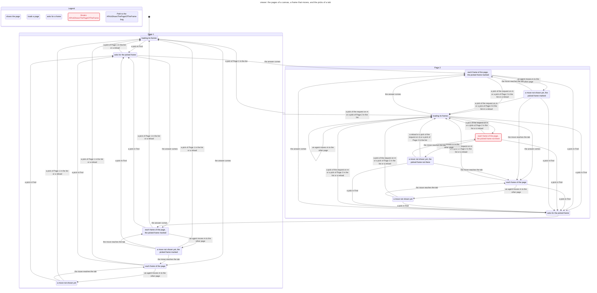

# viewer: the pick of a request that opens the page of the request

This chart has the model of [viewer-pages](viewer-pages.md) with
[ViewerPagesOldPage.cfg](models/pages/ViewerPagesOldPage.cfg) (`RequestPick = "byOldPage"`): the
pick of a request opens the page that the request names, the page of the frame when the request
was made. TLC finds that `APickShowsThePageOfTheFrame` breaks in 3 steps:

1. The tab shows Page 1. A person picks the request on `m`. The tab loads Page 2, the page of the
   request.
2. An agent moves `m` to Page 1.
3. The answer comes. The tab shows Page 2, and `m` is not there.

A move before the pick breaks it too, in 4 steps. So the pick of a request asks the server for its
frame, and the answer gives the page where the frame is now (SPEC-pages.md § The viewer, rule 10).
The name of the page in the Requests panel is only a label.

| Rule                                                                                         | In plain words                                                               | Spec anchor                                      |
| -------------------------------------------------------------------------------------------- | ---------------------------------------------------------------------------- | ------------------------------------------------ |
| `APickShowsThePageOfTheFrame`                                                                | Breaks: the tab shows the old page of the frame, and the frame is not there. | SPEC-pages.md § The viewer, rule 10; criterion 3 |
| `TypeOK`, `ATabShowsOnePageAndEachOfItsFrames`, `AReloadShowsTheSamePage`, `TheTabCatchesUp` | Hold.                                                                        | [viewer-pages](viewer-pages.md)                  |

## What the model leaves out

The same as [viewer-pages](viewer-pages.md). TLC checks this config on 76 states.
