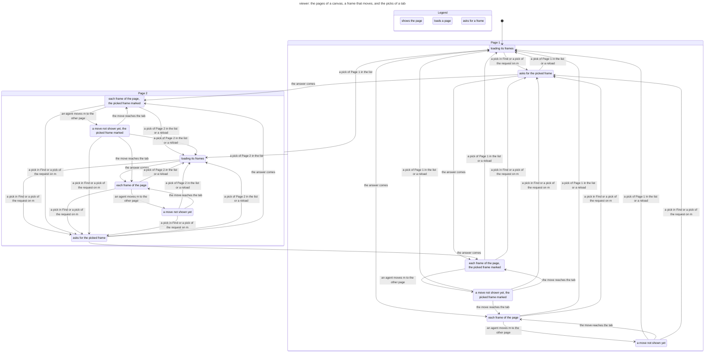

# viewer: the pages of a canvas, a frame that moves, and the picks of a tab

The chart shows one tab of the viewer on a canvas with two pages
([SPEC-pages](../../SPEC-pages.md#the-viewer), rules 7-10). Frame `s` stays on Page 1. Frame `m`
starts on Page 2, and an agent moves it from page to page at any time. The tab loads the frames of
one page only. A move reaches the tab as an event on the socket, a little later. A person picks a
page in the list, picks the request on `m` in the Requests panel, picks a frame in Find, or
reloads. A pick of a frame asks the server for the frame: the answer gives the page where the
frame is now and the frames of that page, in one read. The model is
[models/pages/ViewerPages.tla](models/pages/ViewerPages.tla) with
[ViewerPages.cfg](models/pages/ViewerPages.cfg) (`RequestPick = "byFrame"`). TLC checks every
rule below on all 66 of its states, and each one holds. The chart draws 12 of them: it does not
show on which page `m` is.

| Rule                                 | In plain words                                                                                                                          | Spec anchor                                                |
| ------------------------------------ | --------------------------------------------------------------------------------------------------------------------------------------- | ---------------------------------------------------------- |
| `TypeOK`                             | Each frame is on one page; `s` stays on Page 1. The tab holds one page.                                                                 | SPEC-pages.md § Fact rules, rule 1                         |
| `ATabShowsOnePageAndEachOfItsFrames` | When the tab has its answer and each move, it draws exactly the frames of its page: no frame of the other page, and no frame missing.   | § The viewer, rules 7 and 12; § Model, rule 1; criterion 2 |
| `APickShowsThePageOfTheFrame`        | After a pick of the request or of a found frame, the tab shows the page where the frame is now, and marks the frame. Also after a move. | § The viewer, rules 9 and 10; § Model, rule 2; criterion 3 |
| `AReloadShowsTheSamePage`            | A reload shows the page that the tab showed before it, also during a pick. The address names that page.                                 | § The viewer, rule 8; § Model, rule 3; criterion 4         |
| `TheTabCatchesUp`                    | Each load ends, and each move reaches the tab (with fairness on the answer and on the event of a move).                                 | § The place of a frame, rule 5; criterion 2                |
| `NoDeadlock`                         | There is always a next step.                                                                                                            | (model)                                                    |

## What the model leaves out

- More frames and more pages. One frame that moves and one that stays show each case of a page:
  a frame comes, a frame goes, a frame stays.
- More tabs. Each tab loads and gets the events on its own.
- The place (`x`, `y`) of a frame, pan and zoom, and Fit. A move in the same page changes no page.
- The create, rename, order and delete of pages. A delete of a page with frames is refused, so
  the page of a tab always has its frames.
- An event that comes during a load: the answer of the load is newer, so the tab applies the
  event again with no change.
- The list of Find and the Requests panel: [viewer-find](viewer-find.md) and
  [viewer-queue](viewer-queue.md) prove them. Here a pick is one step.

## What the chart shows

- A pick of a page loads its frames. The pick of a frame keeps the old page on the screen until
  the answer, then shows the page of the frame, with the frame marked.
- When a move takes the marked frame off the page, the tab stays on its page, and the mark ends.
  The tab does not follow the frame.
- A reload goes to "loading its frames" in the same page. The mark is not in the address, so it
  ends.
- [viewer-pages-old-page](viewer-pages-old-page.md) shows why the pick of a request asks for the
  frame, and does not open the page that the request names.
