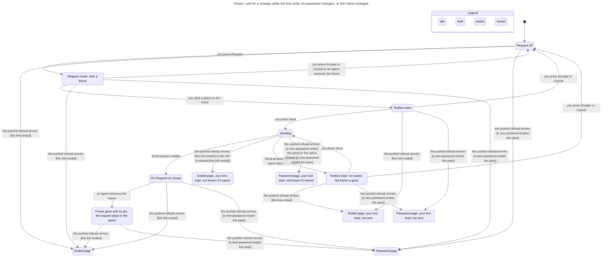

# viewer: a request while its link ends, its password changes, or its frame changes

The chart follows one request from the button `Request` to its pin, while an agent can write or remove the frame and a user can unshare the canvas or set its password. An agent's write leaves an open textbox as it is. An agent's remove leaves it until `Send`, which then answers `gone` and saves nothing; the textbox stays with the text and says the frame is gone. A request saved before the frame was removed stays: its pin goes, and the request stays in the panel. When the link ends, the server pushes the refusal `{ ended: true }`, and the tab shows the ended page at once. When a user sets or changes the password, every pass ends: the server pushes `{ locked: true }`, and the tab goes back to the password page at once. A request being typed stays on either page, to copy: "not sent" while it was still being typed, "not known if it saved" once `Send` was pressed. The model is [models/viewer/ViewerPin.tla](models/viewer/ViewerPin.tla) with [ViewerPinLink.cfg](models/viewer/ViewerPinLink.cfg), where the link can end and the frame can change, and the socket stays up. TLC checks every rule below on all 118 of its states, and each one holds.



| Rule                      | In plain words                                                                                           | Spec line                                                                                    |
| ------------------------- | -------------------------------------------------------------------------------------------------------- | -------------------------------------------------------------------------------------------- |
| `TypeOK`                  | Each value is one the tab or the server can hold.                                                        | (model)                                                                                      |
| `NoTextLost`              | Typed text is never thrown away unsaved: a frame update leaves the textbox, and the ended page keeps it. | SPEC-viewer.md § Ask for a change, step 5; § When the link ends, step 2                      |
| `OneSendOneRequest`       | One request is saved at most once, however often it is sent.                                             | SPEC-viewer.md § Ask for a change, steps 3, 6; judged rule 6                                 |
| `CancelSendsNothing`      | Escape, or the button `Cancel`, closes the textbox and sends nothing.                                    | SPEC-viewer.md § Ask for a change, step 4                                                    |
| `GoneSendsNothing`        | If the frame was removed meanwhile, nothing is saved, and the textbox stays with the text.               | SPEC-viewer.md § Ask for a change, step 5                                                    |
| `PinMeansSaved`           | The pin `Request #<n>` shows only for a saved request; a removed frame takes its pins with it.           | SPEC-viewer.md § Watch an agent work, step 3; § Ask for a change, step 3                     |
| `TextboxSaysWhetherSaved` | A textbox that offers `Cancel` has saved nothing. When the page cannot know, the textbox says so.        | SPEC-viewer.md § Ask for a change, steps 6-7; judged rule 6                                  |
| `EndedPageOnly`           | The ended page, and the password page after `{ locked: true }`, show no textbox and no pin.              | SPEC-viewer.md § When the link ends, step 2; § When a password is set, step 2; § Contract    |
| `EndedPageKeepsText`      | The ended page and the password page never say "not sent" of a request that saved.                       | SPEC-viewer.md § When the link ends, step 2; § When a password is set, step 2; judged rule 7 |
| `NoDeadlock`              | There is always a next step.                                                                             | (model)                                                                                      |

## What the model leaves out

- The socket: it stays up here. A tab whose socket is down learns of the end when it is back ([viewer-gate](viewer-gate.md)); sending with a fault is [viewer-pin-post](viewer-pin-post.md).
- The race between the pushed refusal and a `Send` in flight is in: either can reach the server first.
- An agent moving the frame: a pin's place is relative to its frame, so a move changes nothing here.
- More than one write to the frame: one write shows the rule.
- Other tabs, the request's text and its number.
- What follows the password page: a right password opens the canvas again ([viewer-gate](viewer-gate.md)). Here the password page is an end, like the ended page.
- Removing the password, which ends no pass.

## Steps the chart hides

- The view hides no step.
- Steps that stay in one chart state are not drawn: "a user unshares the canvas" and "a user sets or changes the password" (the tab changes only when the pushed refusal arrives), "an agent writes the frame" (the textbox stays as it is), "an agent removes the frame" while the textbox is open (it stays until `Send`), and "nothing more happens" on the ended page or after the request closed.

## Make it again

```sh
scripts/statecharts.sh viewer-pin-link          # rewrite this page's mermaid block in place if it differs
scripts/statecharts.sh --check viewer-pin-link  # change nothing; compare the block and the verdict in charts.tsv
```
