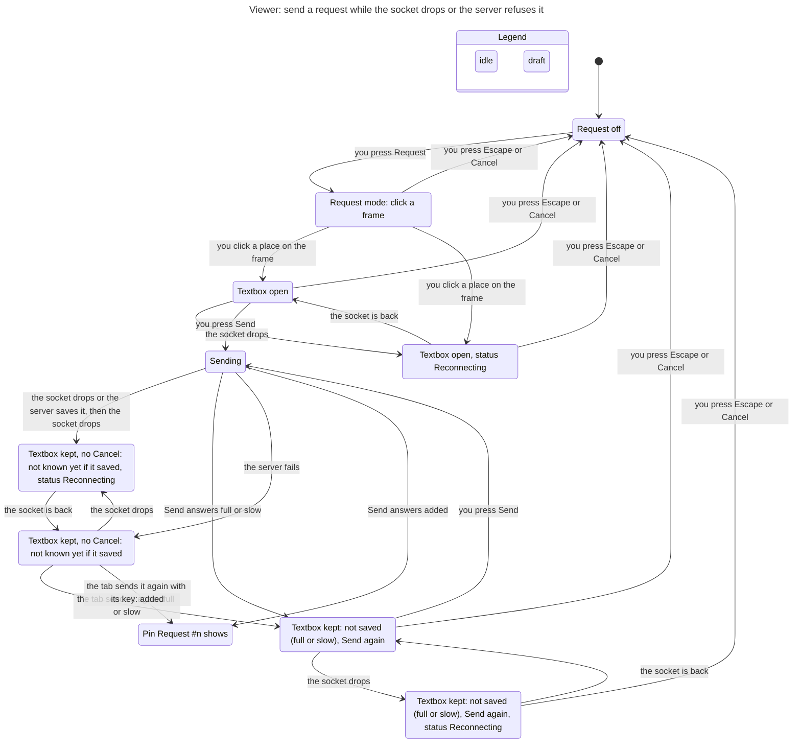

# viewer: send a request while the socket drops

The chart follows one request from the button `Request` to its pin, while the socket can drop. The textbox gets a client key when it opens, and every send of that request carries it, so the server saves it once however often it is sent. When the call faults, the textbox stays with the text, says it is not known yet whether it saved, and offers no `Cancel`. When the socket is back, the page sends the request again with the same key, and the answer `added` shows the pin. A key the server has seen answers `added` before it looks at the frame. A canvas with too many open requests answers `full`, and a pass that sends too fast `slow`, to a first send or to a resend alike: nothing is saved (a key the server has seen answers `added` first), and the textbox stays, says it was not saved, and offers `Send` again. A server fault (`failed`) saved nothing in that call, but an earlier send may have, so the textbox stays "not known yet if it saved", with no `Cancel`, and `Send` sends it again. The model is [models/viewer/ViewerPin.tla](models/viewer/ViewerPin.tla) with [ViewerPinPost.cfg](models/viewer/ViewerPinPost.cfg), where the socket can drop and the link and the frame stay. TLC checks every rule below on all 16 of its states, and each one holds.



| Rule                      | In plain words                                                                                                                                  | Spec line                                                               |
| ------------------------- | ----------------------------------------------------------------------------------------------------------------------------------------------- | ----------------------------------------------------------------------- |
| `TypeOK`                  | Each value is one the tab or the server can hold.                                                                                               | (model)                                                                 |
| `NoTextLost`              | Typed text is never thrown away unsaved: a frame update leaves the textbox, and the ended page keeps it.                                        | SPEC-viewer.md § Ask for a change, step 5; § When the link ends, step 2 |
| `OneSendOneRequest`       | One request is saved at most once, however often it is sent.                                                                                    | SPEC-viewer.md § Ask for a change, steps 3, 6; judged rule 6            |
| `CancelSendsNothing`      | Escape, or the button `Cancel`, closes the textbox and sends nothing.                                                                           | SPEC-viewer.md § Ask for a change, step 4; judged rule 6                |
| `GoneSendsNothing`        | If the frame was removed meanwhile, nothing is saved, and the textbox stays with the text and says the frame is gone.                           | SPEC-viewer.md § Ask for a change, step 5                               |
| `PinMeansSaved`           | The pin `Request #<n>` shows only for a saved request.                                                                                          | SPEC-viewer.md § Ask for a change, step 3                               |
| `TextboxSaysWhetherSaved` | A textbox that offers `Cancel` has saved nothing, as after `full` or `slow`. When the page cannot know, as after `failed`, the textbox says so. | SPEC-viewer.md § Ask for a change, steps 6-7; judged rule 6             |
| `EndedPageOnly`           | The ended page shows no textbox and no pin.                                                                                                     | SPEC-viewer.md § When the link ends, step 2                             |
| `EndedPageKeepsText`      | The ended page never says "not sent" of a request that saved.                                                                                   | SPEC-viewer.md § When the link ends, step 2; judged rule 7              |
| `NoDeadlock`              | There is always a next step.                                                                                                                    | (model)                                                                 |

## What the model leaves out

- The text of the request, its place on the frame, and its number `n`.
- `full` and `slow` are one answer in the model: they act alike.
- After `failed`, the resend waits for the viewer's `Send`; in the model, the resend from "not known yet" can come at any time, as after the socket is back.
- `failed` never makes the textbox say "not saved": an earlier send of the draft may have saved, and `TextboxSaysWhetherSaved` would break.
- Other tabs. A pin shows in every tab on the canvas by the board, as in [viewer-canvas](viewer-canvas.md).
- A second request. One request per run shows each rule; a second repeats the first.
- The link ending and the frame changing: [viewer-pin-link](viewer-pin-link.md).

## Steps the chart hides

- The view hides no step.
- Steps that stay in one chart state are not drawn: the socket dropping or coming back while `Request` is off or in request mode, a resend from "not known yet" that fails again, and "nothing more happens" after the pin shows or after `Cancel`.

## Make it again

```sh
scripts/statecharts.sh viewer-pin-post          # rewrite this page's mermaid block in place if it differs
scripts/statecharts.sh --check viewer-pin-post  # change nothing; compare the block and the verdict in charts.tsv
```
