# viewer: one request in the Requests panel

The chart follows one request in the panel `Requests` while agents and viewers work on it. The board stores no "in work" and no "needs a person": the page derives them from `claimedUntil`, `tries` and the server's time, read from a clock capsule (the page's clock plus the server's offset, carried by the board). So when a lease runs out, nothing is written, and the panel shows the request waiting again, or as "needs a person" after its last try. A claim, an outcome and each call of a viewer reach every connected tab at once. A viewer can take back a request while an agent works on it, and the claim ends with it. The count on the button `Requests` counts the request while it waits for a viewer. The mark `Changed` shows after each change, until the viewer opens the request. While the socket is down, the panel says `Reconnecting`, and the full board read when it is back brings it up to date. The model is [models/viewer/ViewerQueue.tla](models/viewer/ViewerQueue.tla) with [ViewerQueue.cfg](models/viewer/ViewerQueue.cfg). TLC checks every rule below on all 358 of its states, and each one holds.

```mermaid
---
title: "Viewer: one request in the Requests panel while agents and viewers work on it"
---
stateDiagram-v2
  state "Request Waiting" as s0 {
    state "Panel Shows waiting" as s1 {
      s2: Mark No mark
      s3: Mark Marked changed
    }
    state "Panel Status Reconnecting (may be behind)" as s4 {
      s5: Mark No mark
      s6: Mark Marked changed
    }
  }
  state "Request Closed" as s7 {
    state "Panel Shows closed, in the Done group" as s8 {
      s9: Mark Marked changed
      s10: Mark No mark
    }
    state "Panel Status Reconnecting (may be behind)" as s11 {
      s12: Mark Marked changed
      s13: Mark No mark
    }
  }
  state "Request In work, lease live" as s14 {
    state "Panel Shows in work, with the agent name" as s15 {
      s16: Mark Marked changed
      s17: Mark No mark
    }
    state "Panel Status Reconnecting (may be behind)" as s18 {
      s19: Mark Marked changed
      s20: Mark No mark
    }
  }
  state "Request Question for a viewer" as s21 {
    state "Panel Shows the question, counted for a viewer" as s22 {
      s23: Mark Marked changed
      s24: Mark No mark
    }
    state "Panel Status Reconnecting (may be behind)" as s25 {
      s26: Mark Marked changed
      s27: Mark No mark
    }
  }
  state "Request Needs a person: declined" as s28 {
    state "Panel Shows needs a person, with the reason, counted for a viewer" as s29 {
      s30: Mark Marked changed
      s31: Mark No mark
    }
    state "Panel Status Reconnecting (may be behind)" as s32 {
      s33: Mark Marked changed
      s34: Mark No mark
    }
  }
  state "Request Result to check" as s35 {
    state "Panel Shows the result, counted for a viewer" as s36 {
      s37: Mark Marked changed
      s38: Mark No mark
    }
    state "Panel Status Reconnecting (may be behind)" as s39 {
      s40: Mark Marked changed
      s41: Mark No mark
    }
  }
  state "Request Accepted" as s42 {
    state "Panel Shows accepted, in the Done group" as s43 {
      s44: Mark Marked changed
      s45: Mark No mark
    }
    state "Panel Status Reconnecting (may be behind)" as s46 {
      s47: Mark Marked changed
      s48: Mark No mark
    }
  }
  state "Request Needs a person: no outcome after 2 tries" as s49 {
    state "Panel Shows needs a person, counted for a viewer" as s50 {
      s51: Mark Marked changed
      s52: Mark No mark
    }
    state "Panel Status Reconnecting (may be behind)" as s53 {
      s54: Mark Marked changed
      s55: Mark No mark
    }
  }
  [*] --> s2
  s2 --> s5: the socket drops
  s2 --> s3: a viewer edits it
  s5 --> s2: the socket is back, the board is read
  s5 --> s6: a viewer edits it
  s9 --> s12: the socket drops
  s9 --> s10: you open it
  s3 --> s2: you open it
  s3 --> s6: the socket drops
  s16 --> s19: the socket drops
  s16 --> s17: you open it
  s16 --> s3: the lease runs out
  s12 --> s9: the socket is back, the board is read
  s6 --> s3: the socket is back, the board is read
  s19 --> s16: the socket is back, the board is read
  s19 --> s6: the lease runs out
  s10 --> s13: the socket drops
  s23 --> s26: the socket drops
  s23 --> s24: you open it
  s30 --> s33: the socket drops
  s30 --> s31: you open it
  s37 --> s40: the socket drops
  s37 --> s38: you open it
  s17 --> s20: the socket drops
  s17 --> s2: the lease runs out
  s13 --> s10: the socket is back, the board is read
  s26 --> s23: the socket is back, the board is read
  s33 --> s30: the socket is back, the board is read
  s40 --> s37: the socket is back, the board is read
  s44 --> s47: the socket drops
  s44 --> s45: you open it
  s24 --> s27: the socket drops
  s31 --> s34: the socket drops
  s38 --> s41: the socket drops
  s20 --> s17: the socket is back, the board is read
  s20 --> s5: the lease runs out
  s16 --> s51: the lease runs out
  s47 --> s44: the socket is back, the board is read
  s19 --> s54: the lease runs out
  s27 --> s24: the socket is back, the board is read
  s34 --> s31: the socket is back, the board is read
  s41 --> s38: the socket is back, the board is read
  s45 --> s48: the socket drops
  s51 --> s54: the socket drops
  s51 --> s52: you open it
  s17 --> s52: the lease runs out
  s54 --> s51: the socket is back, the board is read
  s48 --> s45: the socket is back, the board is read
  s52 --> s55: the socket drops
  s20 --> s55: the lease runs out
  s55 --> s52: the socket is back, the board is read
  s1 --> s9: a viewer closes it
  s1 --> s16: an agent claims it (easel next)
  s4 --> s12: a viewer closes it
  s4 --> s19: an agent claims it (easel next)
  s15 --> s23: the agent asks a question
  s15 --> s9: a viewer takes it back
  s15 --> s3: the agent releases it
  s15 --> s30: the agent declines it
  s15 --> s37: the agent resolves it
  s15 --> s51: the agent releases it
  s18 --> s26: the agent asks a question
  s18 --> s12: a viewer takes it back
  s18 --> s6: the agent releases it
  s18 --> s33: the agent declines it
  s18 --> s40: the agent resolves it
  s18 --> s54: the agent releases it
  s22 --> s3: a viewer answers
  s22 --> s9: a viewer closes it
  s29 --> s3: a viewer edits it
  s29 --> s9: a viewer closes it
  s36 --> s3: a viewer opens it again
  s36 --> s44: a viewer accepts the result
  s25 --> s6: a viewer answers
  s25 --> s12: a viewer closes it
  s32 --> s6: a viewer edits it
  s32 --> s12: a viewer closes it
  s39 --> s6: a viewer opens it again
  s39 --> s47: a viewer accepts the result
  s43 --> s3: a viewer opens it again
  s46 --> s6: a viewer opens it again
  s50 --> s3: a viewer edits it
  s50 --> s9: a viewer closes it
  s53 --> s6: a viewer edits it
  s53 --> s12: a viewer closes it
```



| Rule                       | In plain words                                                                                                    | Spec line                                                  |
| -------------------------- | ----------------------------------------------------------------------------------------------------------------- | ---------------------------------------------------------- |
| `TypeOK`                   | Each value is one the board or the tab can hold.                                                                  | (model)                                                    |
| `PanelShowsLatest`         | Each change of the request shows in every connected tab at once, with no reload.                                  | SPEC-viewer.md § Lose the socket; § Follow the requests, 5 |
| `LeaseOutShowsWithNoWrite` | A lease that runs out shows the request as waiting again, or as "needs a person", with no write.                  | SPEC-viewer.md § Follow the requests, 5; fact rule 9       |
| `TheCountIsRight`          | The count on `Requests` counts the request exactly while it waits for a viewer: question, result, needs a person. | SPEC-viewer.md § Follow the requests, 1                    |
| `AChangeShowsUntilOpened`  | After a change, the request shows `Changed` until the viewer opens it.                                            | SPEC-viewer.md § Follow the requests, 10                   |
| `NoDeadlock`               | There is always a next step.                                                                                      | (model)                                                    |

## What the model leaves out

- The error in the clock capsule's estimate of server time (about one network delay). The model gives the tab and the server one clock.
- Atomicity: a board write reaches a tab with a live socket in the same step as the write. The code pushes after the write commits; a tab between the two is behind for that moment.
- Who may make each step: [request-life](request-life.md) checks that. Here each viewer step has the guard of its state, and an agent step needs the request in work.
- The number of tries before a request needs a person: 2 in the model, 3 in the queue's spec.
- Extend: it moves `claimedUntil` and changes nothing the panel shows.
- The time of the last visit. The model keeps one flag for "the viewer opened the request after its last change". A new visit only hides the marks of changes before it, and that adds no step to check.
- "May be outdated": a mark from the frame version and the age. It does not change the state ([queue](../../SPEC-queue.md)).
- Many requests and their order, the lists and groups, the agent's name, and the messages.
- "Done, no answer": after 3 days with no answer, the page shows a result as done and stops counting it. The model has no time of day, so it counts a result until a viewer acts.
- The status `Reconnecting` while the full read is in flight: [viewer-canvas](viewer-canvas.md) has it.

## Steps the chart hides

- The view hides no step.
- Steps that change no label are not drawn. A step while the socket is down shows only in the Request and Mark parts; the panel stays at "Status Reconnecting (may be behind)".

## Make it again

```sh
scripts/statecharts.sh viewer-queue          # rewrite this page's mermaid block in place if it differs
scripts/statecharts.sh --check viewer-queue  # change nothing; compare the block and the verdict in charts.tsv
```
