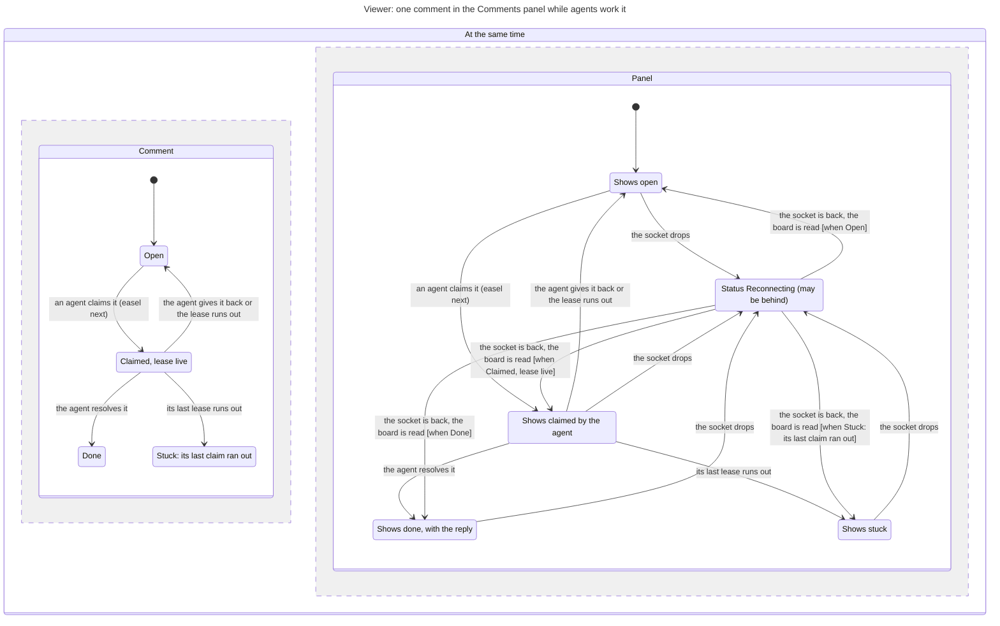

# viewer: one comment in the Comments panel

The chart follows one comment in the panel `Comments` while agents work it. The board stores no `claimed` state: the panel shows a comment claimed while its `claimedUntil` is ahead of the server's time, read from a clock capsule (the page's clock plus the server's offset, carried by the board). So when a lease runs out, nothing is written, and the panel shows the comment open, or stuck after its last allowed claim. A claim, a resolve and a give-back reach every connected tab at once. While the socket is down, the panel says `Reconnecting`, and the full board read when it is back brings it up to date. The model is [models/viewer/ViewerQueue.tla](models/viewer/ViewerQueue.tla) with [ViewerQueue.cfg](models/viewer/ViewerQueue.cfg). TLC checks every rule below on all 44 of its states, and each one holds.



| Rule                | In plain words                                                                                                                                | Spec line                                                       |
| ------------------- | --------------------------------------------------------------------------------------------------------------------------------------------- | --------------------------------------------------------------- |
| `TypeOK`            | Each value is one the board or the tab can hold.                                                                                              | (model)                                                         |
| `LeaseOutShowsOpen` | If an agent's lease runs out before it resolves, the comment shows as open again (or stuck), with no write. By construction (judged in code). | SPEC-viewer.md § Follow the queue, step 4; fact rule 9          |
| `PanelShowsLatest`  | When an agent claims, resolves or gives back a comment, every connected tab shows it at once.                                                 | SPEC-viewer.md § Lose the socket; § Follow the queue, steps 2-3 |
| `DoneStaysDone`     | A done comment shows as done, with the reply, and never as open or claimed again. By construction (judged in code).                           | SPEC-viewer.md § Follow the queue, step 3                       |
| `StuckShowsStuck`   | A comment whose last allowed claim ran out shows as stuck, not as open. By construction (judged in code).                                     | SPEC-viewer.md § Follow the queue, steps 1, 5                   |
| `NoDeadlock`        | There is always a next step.                                                                                                                  | (model)                                                         |

## What the model leaves out

- The error in the clock capsule's estimate of server time (about one network delay). The model gives the tab and the server one clock.
- Atomicity: a board write reaches a tab with a live socket in the same step as the write. The code pushes after the write commits; a tab between the two is behind for that moment.
- `LeaseOutShowsOpen`, `DoneStaysDone` and `StuckShowsStuck` hold by construction: the panel and the queue read a comment's state with one function, and `PanelShowsLatest` already gives them. No variant breaks them; the code is judged against them (the panel reads time only from the clock capsule).
- The number of claims before a comment is stuck: 2 in the model, 3 in the queue's spec.
- Extend: it moves `claimedUntil` and changes nothing the panel shows.
- Many comments and their order, the agent's name, and the reply's text.
- The status `Reconnecting` while the full read is in flight: [viewer-canvas](viewer-canvas.md) has it.

## Steps the chart hides

- The view hides no step.
- Steps that change neither part's label are not drawn. A step while the socket is down shows only in the Comment part; the panel stays at "Status Reconnecting (may be behind)".

## Make it again

```sh
scripts/statecharts.sh viewer-queue          # rewrite this page's mermaid block in place if it differs
scripts/statecharts.sh --check viewer-queue  # change nothing; compare the block and the verdict in charts.tsv
```
