# viewer: one screenshot on a request

The chart follows the textbox of one request, from the click that opens it to the save. The textbox holds at most one screenshot: an image that the person pastes, or a part of the frame of the request that the person takes with `Take a part`. A second screenshot replaces the first, and a button removes it. In the pick, the person drags a box on the frame, and Escape ends the pick only: the text and the screenshot stay. `Send` sends the text and the screenshot in one call, and the request keeps both. A paste that is not a PNG, JPEG or WebP of at most 10 MiB, or an image that the server refuses, never goes with the request: the textbox keeps the text and says why. The model is [models/viewer/RequestShot.tla](models/viewer/RequestShot.tla) with [RequestShot.cfg](models/viewer/RequestShot.cfg). TLC checks every rule below on all 33 of its states, and each one holds.

```mermaid
---
title: "viewer: one screenshot on a request, pasted or taken from a part of its frame"
---
stateDiagram-v2
  state "Legend" as legend {
    lg0: idle
    lg1: draft
    lg2: saved
  }
  class lg0 tan
  class lg1 blue
  class lg2 teal
  s0: No textbox
  s1: Textbox open, on the canvas, no screenshot
  s2: Textbox open, on a frame, no screenshot
  s3: Textbox open, on the canvas, a pasted image
  s4: Textbox open, on a frame, a pasted image
  s5: Sending, on the canvas, no screenshot
  s6: Sending, on a frame, no screenshot
  s7: Textbox open, on a frame, drag a box on the frame, no screenshot
  s8: Textbox open, on the canvas, no screenshot, says the screenshot was refused
  s9: Textbox open, on a frame, no screenshot, says the screenshot was refused
  s10: Sending, on the canvas, a pasted image
  s11: Sending, on a frame, a pasted image
  s12: Textbox open, on a frame, drag a box on the frame, a pasted image
  s13: Textbox open, on the canvas, a pasted image, says the screenshot was refused
  s14: Textbox open, on a frame, a pasted image, says the screenshot was refused
  s15: Request #35;n saved, with no screenshot
  s16: Sending, on the canvas, no screenshot, says the screenshot was refused
  s17: Sending, on a frame, no screenshot, says the screenshot was refused
  s18: Textbox open, on a frame, drag a box on the frame, no screenshot, says the screenshot was refused
  s19: Textbox open, on a frame, a part of the frame
  s20: Sending, on the canvas, a pasted image, says the screenshot was refused
  s21: Sending, on a frame, a pasted image, says the screenshot was refused
  s22: Textbox open, on a frame, drag a box on the frame, a pasted image, says the screenshot was refused
  s23: Request #35;n saved, with the pasted image
  s24: Sending, on a frame, a part of the frame
  s25: Textbox open, on a frame, drag a box on the frame, a part of the frame
  s26: Textbox open, on a frame, a part of the frame, says the screenshot was refused
  s27: Request #35;n saved, with the part of the frame
  s28: Sending, on a frame, a part of the frame, says the screenshot was refused
  s29: Textbox open, on a frame, drag a box on the frame, a part of the frame, says the screenshot was refused
  [*] --> s0
  s0 --> s1: a click on the canvas
  s0 --> s2: a click on a frame
  s1 --> s0: you press Escape or Cancel
  s1 --> s3: a paste of an image
  s1 --> s5: you press Send
  s1 --> s8: a paste of another file, or an image over 10 MiB: refused
  s2 --> s0: you press Escape or Cancel
  s2 --> s4: a paste of an image
  s2 --> s6: you press Send
  s2 --> s7: you press Take a part
  s2 --> s9: a paste of another file, or an image over 10 MiB: refused
  s3 --> s0: you press Escape or Cancel
  s3 --> s1: you remove the screenshot
  s3 --> s10: you press Send
  s3 --> s13: a paste of another file, or an image over 10 MiB: refused
  s4 --> s0: you press Escape or Cancel
  s4 --> s2: you remove the screenshot
  s4 --> s11: you press Send
  s4 --> s12: you press Take a part
  s4 --> s14: a paste of another file, or an image over 10 MiB: refused
  s5 --> s15: Send answers added
  s6 --> s15: Send answers added
  s7 --> s2: you press Escape: the pick ends, the text stays
  s7 --> s19: you drag a box on the frame
  s8 --> s0: you press Escape or Cancel
  s8 --> s3: a paste of an image
  s8 --> s16: you press Send
  s9 --> s0: you press Escape or Cancel
  s9 --> s4: a paste of an image
  s9 --> s17: you press Send
  s9 --> s18: you press Take a part
  s10 --> s8: the server refuses the image: the text stays
  s10 --> s23: Send answers added
  s11 --> s9: the server refuses the image: the text stays
  s11 --> s23: Send answers added
  s12 --> s4: you press Escape: the pick ends, the text stays
  s12 --> s19: you drag a box: it replaces the screenshot
  s13 --> s0: you press Escape or Cancel
  s13 --> s3: a paste of an image: it replaces the screenshot
  s13 --> s8: you remove the screenshot
  s13 --> s20: you press Send
  s14 --> s0: you press Escape or Cancel
  s14 --> s4: a paste of an image: it replaces the screenshot
  s14 --> s9: you remove the screenshot
  s14 --> s21: you press Send
  s14 --> s22: you press Take a part
  s16 --> s15: Send answers added
  s17 --> s15: Send answers added
  s18 --> s9: you press Escape: the pick ends, the text stays
  s18 --> s19: you drag a box on the frame
  s19 --> s0: you press Escape or Cancel
  s19 --> s2: you remove the screenshot
  s19 --> s4: a paste of an image: it replaces the screenshot
  s19 --> s24: you press Send
  s19 --> s25: you press Take a part
  s19 --> s26: a paste of another file, or an image over 10 MiB: refused
  s20 --> s8: the server refuses the image: the text stays
  s20 --> s23: Send answers added
  s21 --> s9: the server refuses the image: the text stays
  s21 --> s23: Send answers added
  s22 --> s14: you press Escape: the pick ends, the text stays
  s22 --> s19: you drag a box: it replaces the screenshot
  s24 --> s27: Send answers added
  s25 --> s19: you press Escape: the pick ends, the text stays or you drag a box: it replaces the screenshot
  s26 --> s0: you press Escape or Cancel
  s26 --> s4: a paste of an image: it replaces the screenshot
  s26 --> s9: you remove the screenshot
  s26 --> s28: you press Send
  s26 --> s29: you press Take a part
  s28 --> s27: Send answers added
  s29 --> s19: you drag a box: it replaces the screenshot
  s29 --> s26: you press Escape: the pick ends, the text stays
  class s0 tan
  class s1 blue
  class s2 blue
  class s3 blue
  class s4 blue
  class s5 blue
  class s6 blue
  class s7 blue
  class s8 blue
  class s9 blue
  class s10 blue
  class s11 blue
  class s12 blue
  class s13 blue
  class s14 blue
  class s15 teal
  class s16 blue
  class s17 blue
  class s18 blue
  class s19 blue
  class s20 blue
  class s21 blue
  class s22 blue
  class s23 teal
  class s24 blue
  class s25 blue
  class s26 blue
  class s27 teal
  class s28 blue
  class s29 blue
```

| Rule                        | In plain words                                                                               | Spec line                                 |
| --------------------------- | -------------------------------------------------------------------------------------------- | ----------------------------------------- |
| `TypeOK`                    | Each value is one the tab or the server can hold.                                            | (model)                                   |
| `PickOnlyOnAFrame`          | `Take a part` takes a part of the frame of the request; a request on the canvas has none.    | SPEC-queue.md § A screenshot on a request |
| `NoSendWhilePicking`        | No send while the pick is on, so the screenshot that goes is the one that the textbox shows. | SPEC-queue.md § A screenshot on a request |
| `SavedIsWhatWasShown`       | The request keeps the screenshot that the textbox held at `Send`, and only that one.         | SPEC-queue.md § A screenshot on a request |
| `EscapeInPickKeepsTheDraft` | Escape in the pick ends the pick, and keeps the textbox, its text and its screenshot.        | SPEC-queue.md § A screenshot on a request |
| `RefusedIsNeverSaved`       | A refused paste, or an image that the server refuses, never goes with a request.             | SPEC-queue.md § A screenshot on a request |
| `NoDeadlock`                | There is always a next step.                                                                 | (model)                                   |

## What the model leaves out

- The text of the request, the socket, and the answers `full`, `slow` and `gone`: [viewer-pin-post](viewer-pin-post.md) and [viewer-pin-link](viewer-pin-link.md) show them, and the screenshot does not change them.
- The size of the box and the bytes of the image.
- The image that a person drops on the board, which makes a frame (SPEC-frames § Image frames), not a screenshot.
