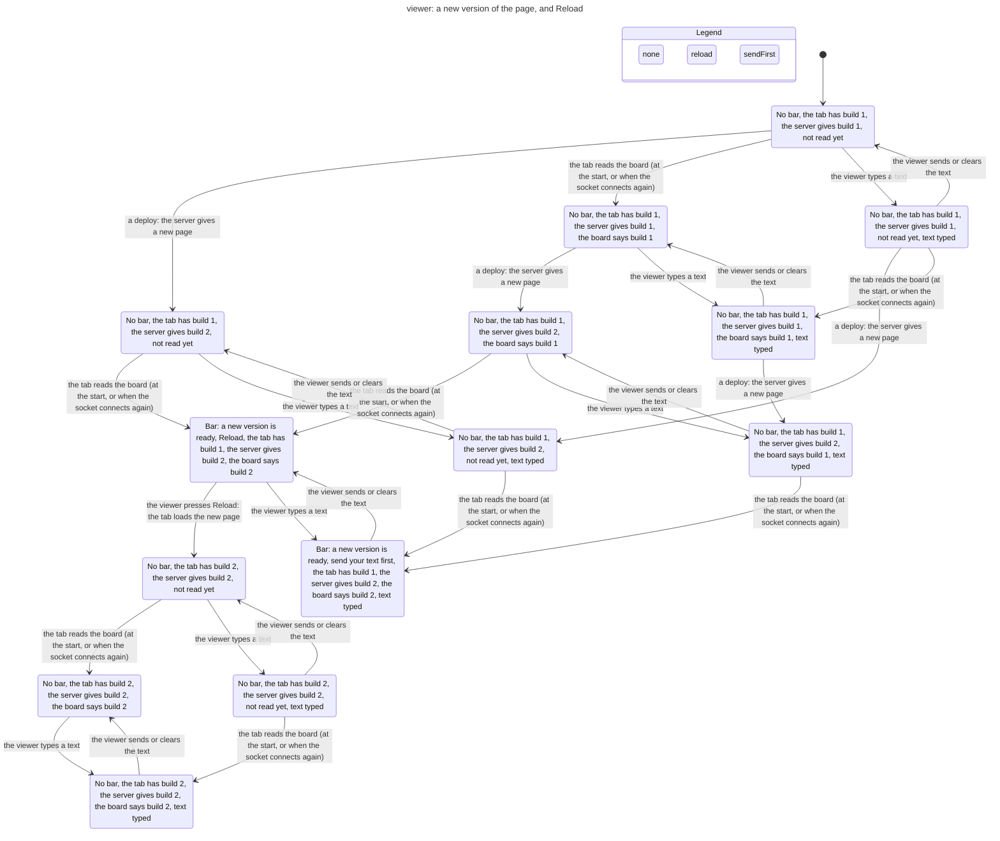

# viewer: a new version of the page, and Reload

The chart follows one tab when easel deploys a new version of the page (SPEC-viewer.md § The page 4; request #12, 2026-11-23). The board's cell `client` names the client of the server's build. The tab keeps the first name that it reads. After a deploy the socket connects again, and a new name says that a new version is ready: a bar shows with `Reload`, as Linear and Slack do. The tab never reloads by itself. While text is typed, the bar asks the viewer to send it first, so a reload loses no text. The model is [models/viewer/NewVersion.tla](models/viewer/NewVersion.tla) with [NewVersion.cfg](models/viewer/NewVersion.cfg).

## The rules

- **TheBarMeansNewer**: the bar shows only when the board names a page that is not the one in the tab.
- **NoTextLost**: a reload happens only with no typed text.
- **OnlyTheViewerReloads**: the tab never reloads by itself. Only the button `Reload` loads a new page.

## What the model leaves out

- A deploy while the page loads: the tab may read the new name first, and then it misses that one version. The next deploy shows the bar.
- The server code alone: a deploy that does not change the page keeps its name, so no bar shows.
