# viewer: why the walk checks each posted state against the map

This chart breaks on purpose. It is [viewer-walk](viewer-walk.md) with a viewer that shows each
state that the frame posts ([WalkAnyPost.cfg](models/viewer/WalkAnyPost.cfg),
`TrustFramePost = TRUE`). The frame runs the code of the project. When the code reaches a state
that the map does not have, such as `x`, or a state that no move of the map reaches from the shown
state, the walk shows a screen that the map and its check do not show. So the viewer shows a
posted state only when a move of the map from the shown state reaches it
([SPEC-prototype](../../SPEC-prototype.md) rule 9). TLC finds `EachStepIsAMove` broken in 2 steps.

```mermaid
---
title: "viewer: the person walks a map of the code"
---
stateDiagram-v2
  state "Legend" as legend {
    lg0: canvas
    lg1: walk
    lg2: request
    lg3: Breaks EachStepIsAMove
    lg4: Path to the EachStepIsAMove bug
  }
  class lg0 tan
  class lg1 teal
  class lg2 blue
  class lg3 breaks
  class lg4 bugPath
  s0: The canvas
  s1: Walk: state name (the first step)
  s2: Walk: state code (steps: name, code)
  s3: Walk: state denied (steps: name, denied)
  s4: Walk: state in (steps: name, in)
  s5: Walk: state x (steps: name, x)
  s6: Walk: state name (the first step), Comment on
  s7: Walk: state denied (steps: name, code, denied)
  s8: Walk: state in (steps: name, code, in)
  s9: Walk: state name (steps: name, code, name)
  s10: Walk: state x (steps: name, code, x)
  s11: Walk: state code (steps: name, code), Comment on
  s12: Walk: state code (steps: name, denied, code)
  s13: Walk: state in (steps: name, denied, in)
  s14: Walk: state name (steps: name, denied, name)
  s15: Walk: state x (steps: name, denied, x)
  s16: Walk: state denied (steps: name, denied), Comment on
  s17: Walk: state code (steps: name, in, code)
  s18: Walk: state denied (steps: name, in, denied)
  s19: Walk: state name (steps: name, in, name)
  s20: Walk: state x (steps: name, in, x)
  s21: Walk: state in (steps: name, in), Comment on
  s22: Walk: state code (steps: name, x, code)
  s23: Walk: state denied (steps: name, x, denied)
  s24: Walk: state in (steps: name, x, in)
  s25: Walk: state name (steps: name, x, name)
  s26: Walk: state x (steps: name, x), Comment on
  s27: Walk: state name (the first step), a request open on the screen
  s28: Walk: state denied (steps: name, code, denied), Comment on
  s29: Walk: state in (steps: name, code, in), Comment on
  s30: Walk: state name (steps: name, code, name), Comment on
  s31: Walk: state x (steps: name, code, x), Comment on
  s32: Walk: state code (steps: name, code), a request open on the screen
  s33: Walk: state code (steps: name, denied, code), Comment on
  s34: Walk: state in (steps: name, denied, in), Comment on
  s35: Walk: state name (steps: name, denied, name), Comment on
  s36: Walk: state x (steps: name, denied, x), Comment on
  s37: Walk: state denied (steps: name, denied), a request open on the screen
  s38: Walk: state code (steps: name, in, code), Comment on
  s39: Walk: state denied (steps: name, in, denied), Comment on
  s40: Walk: state name (steps: name, in, name), Comment on
  s41: Walk: state x (steps: name, in, x), Comment on
  s42: Walk: state in (steps: name, in), a request open on the screen
  s43: Walk: state code (steps: name, x, code), Comment on
  s44: Walk: state denied (steps: name, x, denied), Comment on
  s45: Walk: state in (steps: name, x, in), Comment on
  s46: Walk: state name (steps: name, x, name), Comment on
  s47: Walk: state x (steps: name, x), a request open on the screen
  s48: Walk: state denied (steps: name, code, denied), a request open on the screen
  s49: Walk: state in (steps: name, code, in), a request open on the screen
  s50: Walk: state name (steps: name, code, name), a request open on the screen
  s51: Walk: state x (steps: name, code, x), a request open on the screen
  s52: Walk: state code (steps: name, denied, code), a request open on the screen
  s53: Walk: state in (steps: name, denied, in), a request open on the screen
  s54: Walk: state name (steps: name, denied, name), a request open on the screen
  s55: Walk: state x (steps: name, denied, x), a request open on the screen
  s56: Walk: state code (steps: name, in, code), a request open on the screen
  s57: Walk: state denied (steps: name, in, denied), a request open on the screen
  s58: Walk: state name (steps: name, in, name), a request open on the screen
  s59: Walk: state x (steps: name, in, x), a request open on the screen
  s60: Walk: state code (steps: name, x, code), a request open on the screen
  s61: Walk: state denied (steps: name, x, denied), a request open on the screen
  s62: Walk: state in (steps: name, x, in), a request open on the screen
  s63: Walk: state name (steps: name, x, name), a request open on the screen
  [*] --> s0
  s0 --> s1: a press on the mark of the walk frame, or on the map in the list Maps
  s1 --> s0: Escape: the walk ends or Leave
  s1 --> s2: the code changes the cell: state code
  s1 --> s3: the code changes the cell: state denied
  s1 --> s4: the code changes the cell: state in
  s1 --> s5: the code changes the cell: state x
  s1 --> s6: Comment
  s2 --> s0: Escape: the walk ends or Leave
  s2 --> s1: Back or Restart
  s2 --> s7: the code changes the cell: state denied
  s2 --> s8: the code changes the cell: state in
  s2 --> s9: the code changes the cell: state name
  s2 --> s10: the code changes the cell: state x
  s2 --> s11: Comment
  s3 --> s0: Escape: the walk ends or Leave
  s3 --> s1: Back or Restart
  s3 --> s12: the code changes the cell: state code
  s3 --> s13: the code changes the cell: state in
  s3 --> s14: the code changes the cell: state name
  s3 --> s15: the code changes the cell: state x
  s3 --> s16: Comment
  s4 --> s0: Escape: the walk ends or Leave
  s4 --> s1: Back or Restart
  s4 --> s17: the code changes the cell: state code
  s4 --> s18: the code changes the cell: state denied
  s4 --> s19: the code changes the cell: state name
  s4 --> s20: the code changes the cell: state x
  s4 --> s21: Comment
  s5 --> s0: Escape: the walk ends or Leave
  s5 --> s1: Back or Restart
  s5 --> s22: the code changes the cell: state code
  s5 --> s23: the code changes the cell: state denied
  s5 --> s24: the code changes the cell: state in
  s5 --> s25: the code changes the cell: state name
  s5 --> s26: Comment
  s6 --> s0: Leave
  s6 --> s1: Comment or Escape: the request mode ends
  s6 --> s27: a press on the screen in the request mode
  s7 --> s0: Escape: the walk ends or Leave
  s7 --> s1: Restart
  s7 --> s2: Back
  s7 --> s28: Comment
  s8 --> s0: Escape: the walk ends or Leave
  s8 --> s1: Restart
  s8 --> s2: Back
  s8 --> s29: Comment
  s9 --> s0: Escape: the walk ends or Leave
  s9 --> s1: Restart
  s9 --> s2: Back
  s9 --> s30: Comment
  s10 --> s0: Escape: the walk ends or Leave
  s10 --> s1: Restart
  s10 --> s2: Back
  s10 --> s31: Comment
  s11 --> s0: Leave
  s11 --> s2: Comment or Escape: the request mode ends
  s11 --> s32: a press on the screen in the request mode
  s12 --> s0: Escape: the walk ends or Leave
  s12 --> s1: Restart
  s12 --> s3: Back
  s12 --> s33: Comment
  s13 --> s0: Escape: the walk ends or Leave
  s13 --> s1: Restart
  s13 --> s3: Back
  s13 --> s34: Comment
  s14 --> s0: Escape: the walk ends or Leave
  s14 --> s1: Restart
  s14 --> s3: Back
  s14 --> s35: Comment
  s15 --> s0: Escape: the walk ends or Leave
  s15 --> s1: Restart
  s15 --> s3: Back
  s15 --> s36: Comment
  s16 --> s0: Leave
  s16 --> s3: Comment or Escape: the request mode ends
  s16 --> s37: a press on the screen in the request mode
  s17 --> s0: Escape: the walk ends or Leave
  s17 --> s1: Restart
  s17 --> s4: Back
  s17 --> s38: Comment
  s18 --> s0: Escape: the walk ends or Leave
  s18 --> s1: Restart
  s18 --> s4: Back
  s18 --> s39: Comment
  s19 --> s0: Escape: the walk ends or Leave
  s19 --> s1: Restart
  s19 --> s4: Back
  s19 --> s40: Comment
  s20 --> s0: Escape: the walk ends or Leave
  s20 --> s1: Restart
  s20 --> s4: Back
  s20 --> s41: Comment
  s21 --> s0: Leave
  s21 --> s4: Comment or Escape: the request mode ends
  s21 --> s42: a press on the screen in the request mode
  s22 --> s0: Escape: the walk ends or Leave
  s22 --> s1: Restart
  s22 --> s5: Back
  s22 --> s43: Comment
  s23 --> s0: Escape: the walk ends or Leave
  s23 --> s1: Restart
  s23 --> s5: Back
  s23 --> s44: Comment
  s24 --> s0: Escape: the walk ends or Leave
  s24 --> s1: Restart
  s24 --> s5: Back
  s24 --> s45: Comment
  s25 --> s0: Escape: the walk ends or Leave
  s25 --> s1: Restart
  s25 --> s5: Back
  s25 --> s46: Comment
  s26 --> s0: Leave
  s26 --> s5: Comment or Escape: the request mode ends
  s26 --> s47: a press on the screen in the request mode
  s27 --> s1: Escape: the request closes or Send
  s28 --> s0: Leave
  s28 --> s7: Comment or Escape: the request mode ends
  s28 --> s48: a press on the screen in the request mode
  s29 --> s0: Leave
  s29 --> s8: Comment or Escape: the request mode ends
  s29 --> s49: a press on the screen in the request mode
  s30 --> s0: Leave
  s30 --> s9: Comment or Escape: the request mode ends
  s30 --> s50: a press on the screen in the request mode
  s31 --> s0: Leave
  s31 --> s10: Comment or Escape: the request mode ends
  s31 --> s51: a press on the screen in the request mode
  s32 --> s2: Escape: the request closes or Send
  s33 --> s0: Leave
  s33 --> s12: Comment or Escape: the request mode ends
  s33 --> s52: a press on the screen in the request mode
  s34 --> s0: Leave
  s34 --> s13: Comment or Escape: the request mode ends
  s34 --> s53: a press on the screen in the request mode
  s35 --> s0: Leave
  s35 --> s14: Comment or Escape: the request mode ends
  s35 --> s54: a press on the screen in the request mode
  s36 --> s0: Leave
  s36 --> s15: Comment or Escape: the request mode ends
  s36 --> s55: a press on the screen in the request mode
  s37 --> s3: Escape: the request closes or Send
  s38 --> s0: Leave
  s38 --> s17: Comment or Escape: the request mode ends
  s38 --> s56: a press on the screen in the request mode
  s39 --> s0: Leave
  s39 --> s18: Comment or Escape: the request mode ends
  s39 --> s57: a press on the screen in the request mode
  s40 --> s0: Leave
  s40 --> s19: Comment or Escape: the request mode ends
  s40 --> s58: a press on the screen in the request mode
  s41 --> s0: Leave
  s41 --> s20: Comment or Escape: the request mode ends
  s41 --> s59: a press on the screen in the request mode
  s42 --> s4: Escape: the request closes or Send
  s43 --> s0: Leave
  s43 --> s22: Comment or Escape: the request mode ends
  s43 --> s60: a press on the screen in the request mode
  s44 --> s0: Leave
  s44 --> s23: Comment or Escape: the request mode ends
  s44 --> s61: a press on the screen in the request mode
  s45 --> s0: Leave
  s45 --> s24: Comment or Escape: the request mode ends
  s45 --> s62: a press on the screen in the request mode
  s46 --> s0: Leave
  s46 --> s25: Comment or Escape: the request mode ends
  s46 --> s63: a press on the screen in the request mode
  s47 --> s5: Escape: the request closes or Send
  s48 --> s7: Escape: the request closes or Send
  s49 --> s8: Escape: the request closes or Send
  s50 --> s9: Escape: the request closes or Send
  s51 --> s10: Escape: the request closes or Send
  s52 --> s12: Escape: the request closes or Send
  s53 --> s13: Escape: the request closes or Send
  s54 --> s14: Escape: the request closes or Send
  s55 --> s15: Escape: the request closes or Send
  s56 --> s17: Escape: the request closes or Send
  s57 --> s18: Escape: the request closes or Send
  s58 --> s19: Escape: the request closes or Send
  s59 --> s20: Escape: the request closes or Send
  s60 --> s22: Escape: the request closes or Send
  s61 --> s23: Escape: the request closes or Send
  s62 --> s24: Escape: the request closes or Send
  s63 --> s25: Escape: the request closes or Send
  classDef breaks fill:#ffecee,stroke:#e72e3b,stroke-width:2.5px,color:#cd2834
  class s0 tan
  class s0 bugPath
  class s1 teal
  class s1 bugPath
  class s2 teal
  class s3 teal
  class s3 breaks
  class s4 teal
  class s4 breaks
  class s4 bugPath
  class s5 teal
  class s5 breaks
  class s6 teal
  class s7 teal
  class s8 teal
  class s9 teal
  class s9 breaks
  class s10 teal
  class s10 breaks
  class s11 teal
  class s12 teal
  class s12 breaks
  class s13 teal
  class s13 breaks
  class s14 teal
  class s14 breaks
  class s15 teal
  class s15 breaks
  class s16 teal
  class s16 breaks
  class s17 teal
  class s17 breaks
  class s18 teal
  class s18 breaks
  class s19 teal
  class s19 breaks
  class s20 teal
  class s20 breaks
  class s21 teal
  class s21 breaks
  class s22 teal
  class s22 breaks
  class s23 teal
  class s23 breaks
  class s24 teal
  class s24 breaks
  class s25 teal
  class s25 breaks
  class s26 teal
  class s26 breaks
  class s27 blue
  class s28 teal
  class s29 teal
  class s30 teal
  class s30 breaks
  class s31 teal
  class s31 breaks
  class s32 blue
  class s33 teal
  class s33 breaks
  class s34 teal
  class s34 breaks
  class s35 teal
  class s35 breaks
  class s36 teal
  class s36 breaks
  class s37 blue
  class s37 breaks
  class s38 teal
  class s38 breaks
  class s39 teal
  class s39 breaks
  class s40 teal
  class s40 breaks
  class s41 teal
  class s41 breaks
  class s42 blue
  class s42 breaks
  class s43 teal
  class s43 breaks
  class s44 teal
  class s44 breaks
  class s45 teal
  class s45 breaks
  class s46 teal
  class s46 breaks
  class s47 blue
  class s47 breaks
  class s48 blue
  class s49 blue
  class s50 blue
  class s50 breaks
  class s51 blue
  class s51 breaks
  class s52 blue
  class s52 breaks
  class s53 blue
  class s53 breaks
  class s54 blue
  class s54 breaks
  class s55 blue
  class s55 breaks
  class s56 blue
  class s56 breaks
  class s57 blue
  class s57 breaks
  class s58 blue
  class s58 breaks
  class s59 blue
  class s59 breaks
  class s60 blue
  class s60 breaks
  class s61 blue
  class s61 breaks
  class s62 blue
  class s62 breaks
  class s63 blue
  class s63 breaks
```

## What the model leaves out

The same as [viewer-walk](viewer-walk.md). A frame that posts an address is the same bug: the
sandbox of the iframe has no `allow-top-navigation`, and the viewer reads no address from a frame.
