# viewer: the backend of the walk, example answers or a live server

The chart follows one tab while the person walks a map with the backend switch
([SPEC-prototype](../../SPEC-prototype.md) ship 5, rule 10, decisions 33 to 39, E12 J10). The
switch has two values. With `examples`, a call of the screen waits until the person picks its
answer in the bar. With `live`, a call goes to the live server: one server of the build on a new
database. At first no live server is set up. Then the hub sets it up, and each deploy starts it.
The model is [models/viewer/WalkBackend.tla](models/viewer/WalkBackend.tla) with
[WalkBackend.cfg](models/viewer/WalkBackend.cfg) (`KeepScope = FALSE`). TLC checks every rule
below on all 38 of its states, and each one holds.

```mermaid
---
title: "viewer: the backend of the walk, example answers or a live server"
---
stateDiagram-v2
  state "Legend" as legend {
    lg0: canvas
    lg1: walk
    lg2: call
    lg3: held
  }
  class lg0 tan
  class lg1 teal
  class lg2 blue
  class lg3 yellow
  s0: Switch: example answers, live server not set up, The canvas
  s1: Switch: example answers, live server not set up, Walk: the first state
  s2: Switch: example answers, live server starting, The canvas
  s3: Switch: live server, live server not set up, The canvas
  s4: Switch: example answers, live server not set up, Walk: the first state, a call waits for the pick of its answer
  s5: Switch: example answers, live server starting, Walk: the first state
  s6: Switch: example answers, live server failed, The canvas
  s7: Switch: example answers, live server ready, The canvas
  s8: Switch: live server, live server not set up, Walk held: the bar says why, no screen runs
  s9: Switch: live server, live server starting, The canvas
  s10: Switch: example answers, live server failed, Walk: the first state
  s11: Switch: example answers, live server ready, Walk: the first state
  s12: Switch: example answers, live server starting, Walk: the first state, a call waits for the pick of its answer
  s13: Switch: example answers, live server not set up, Walk: a later state
  s14: Switch: example answers, live server gone, The canvas
  s15: Switch: live server, live server starting, Walk held: the bar says why, no screen runs
  s16: Switch: live server, live server failed, The canvas
  s17: Switch: live server, live server ready, The canvas
  s18: Switch: example answers, live server failed, Walk: the first state, a call waits for the pick of its answer
  s19: Switch: example answers, live server gone, Walk: the first state
  s20: Switch: example answers, live server ready, Walk: the first state, a call waits for the pick of its answer
  s21: Switch: example answers, live server not set up, Walk: a later state, a call waits for the pick of its answer
  s22: Switch: example answers, live server starting, Walk: a later state
  s23: Switch: live server, live server ready, Walk: the first state
  s24: Switch: live server, live server failed, Walk held: the bar says why, no screen runs
  s25: Switch: live server, live server gone, The canvas
  s26: Switch: example answers, live server gone, Walk: the first state, a call waits for the pick of its answer
  s27: Switch: example answers, live server failed, Walk: a later state
  s28: Switch: example answers, live server ready, Walk: a later state
  s29: Switch: example answers, live server starting, Walk: a later state, a call waits for the pick of its answer
  s30: Switch: live server, live server ready, Walk: the first state, a call waits on the live server
  s31: Switch: live server, live server gone, Walk held: the bar says why, no screen runs
  s32: Switch: example answers, live server failed, Walk: a later state, a call waits for the pick of its answer
  s33: Switch: example answers, live server gone, Walk: a later state
  s34: Switch: example answers, live server ready, Walk: a later state, a call waits for the pick of its answer
  s35: Switch: live server, live server ready, Walk: a later state
  s36: Switch: example answers, live server gone, Walk: a later state, a call waits for the pick of its answer
  s37: Switch: live server, live server ready, Walk: a later state, a call waits on the live server
  [*] --> s0
  s0 --> s1: a press on Walk
  s0 --> s2: the hub sets up the live server
  s0 --> s3: the person picks live server
  s1 --> s0: Leave
  s1 --> s4: a press on the screen makes a call
  s1 --> s5: the hub sets up the live server
  s1 --> s8: the person picks live server
  s2 --> s5: a press on Walk
  s2 --> s6: the live server fails to start
  s2 --> s7: the live server is ready
  s2 --> s9: the person picks live server
  s3 --> s0: the person picks example answers
  s3 --> s8: a press on Walk
  s3 --> s9: the hub sets up the live server
  s4 --> s0: Leave
  s4 --> s8: the person picks live server
  s4 --> s12: the hub sets up the live server
  s4 --> s13: the person picks the answer
  s5 --> s2: Leave
  s5 --> s10: the live server fails to start
  s5 --> s11: the live server is ready
  s5 --> s12: a press on the screen makes a call
  s5 --> s15: the person picks live server
  s6 --> s2: a new deploy
  s6 --> s10: a press on Walk
  s6 --> s16: the person picks live server
  s7 --> s11: a press on Walk
  s7 --> s14: the live server goes
  s7 --> s17: the person picks live server
  s8 --> s1: the person picks example answers
  s8 --> s3: Leave
  s8 --> s15: the hub sets up the live server
  s9 --> s2: the person picks example answers
  s9 --> s15: a press on Walk
  s9 --> s16: the live server fails to start
  s9 --> s17: the live server is ready
  s10 --> s5: a new deploy
  s10 --> s6: Leave
  s10 --> s18: a press on the screen makes a call
  s10 --> s24: the person picks live server
  s11 --> s7: Leave
  s11 --> s19: the live server goes
  s11 --> s20: a press on the screen makes a call
  s11 --> s23: the person picks live server
  s12 --> s2: Leave
  s12 --> s15: the person picks live server
  s12 --> s18: the live server fails to start
  s12 --> s20: the live server is ready
  s12 --> s22: the person picks the answer
  s13 --> s0: Leave
  s13 --> s1: Back or Restart
  s13 --> s8: the person picks live server
  s13 --> s21: a press on the screen makes a call
  s13 --> s22: the hub sets up the live server
  s14 --> s2: a new deploy
  s14 --> s19: a press on Walk
  s14 --> s25: the person picks live server
  s15 --> s5: the person picks example answers
  s15 --> s9: Leave
  s15 --> s23: the live server is ready
  s15 --> s24: the live server fails to start
  s16 --> s6: the person picks example answers
  s16 --> s9: a new deploy
  s16 --> s24: a press on Walk
  s17 --> s7: the person picks example answers
  s17 --> s23: a press on Walk
  s17 --> s25: the live server goes
  s18 --> s6: Leave
  s18 --> s12: a new deploy
  s18 --> s24: the person picks live server
  s18 --> s27: the person picks the answer
  s19 --> s5: a new deploy
  s19 --> s14: Leave
  s19 --> s26: a press on the screen makes a call
  s19 --> s31: the person picks live server
  s20 --> s7: Leave
  s20 --> s23: the person picks live server
  s20 --> s26: the live server goes
  s20 --> s28: the person picks the answer
  s21 --> s0: Leave
  s21 --> s1: Back or Restart
  s21 --> s8: the person picks live server
  s21 --> s13: the person picks the answer
  s21 --> s29: the hub sets up the live server
  s22 --> s2: Leave
  s22 --> s5: Back or Restart
  s22 --> s15: the person picks live server
  s22 --> s27: the live server fails to start
  s22 --> s28: the live server is ready
  s22 --> s29: a press on the screen makes a call
  s23 --> s11: the person picks example answers
  s23 --> s17: Leave
  s23 --> s30: a press on the screen makes a call
  s23 --> s31: the live server goes
  s24 --> s10: the person picks example answers
  s24 --> s15: a new deploy
  s24 --> s16: Leave
  s25 --> s9: a new deploy
  s25 --> s14: the person picks example answers
  s25 --> s31: a press on Walk
  s26 --> s12: a new deploy
  s26 --> s14: Leave
  s26 --> s31: the person picks live server
  s26 --> s33: the person picks the answer
  s27 --> s6: Leave
  s27 --> s10: Back or Restart
  s27 --> s22: a new deploy
  s27 --> s24: the person picks live server
  s27 --> s32: a press on the screen makes a call
  s28 --> s7: Leave
  s28 --> s11: Back or Restart
  s28 --> s23: the person picks live server
  s28 --> s33: the live server goes
  s28 --> s34: a press on the screen makes a call
  s29 --> s2: Leave
  s29 --> s5: Back or Restart
  s29 --> s15: the person picks live server
  s29 --> s22: the person picks the answer
  s29 --> s32: the live server fails to start
  s29 --> s34: the live server is ready
  s30 --> s11: the person picks example answers
  s30 --> s17: Leave
  s30 --> s31: the live server goes
  s30 --> s35: the live server answers
  s31 --> s15: a new deploy
  s31 --> s19: the person picks example answers
  s31 --> s25: Leave
  s32 --> s6: Leave
  s32 --> s10: Back or Restart
  s32 --> s24: the person picks live server
  s32 --> s27: the person picks the answer
  s32 --> s29: a new deploy
  s33 --> s14: Leave
  s33 --> s19: Back or Restart
  s33 --> s22: a new deploy
  s33 --> s31: the person picks live server
  s33 --> s36: a press on the screen makes a call
  s34 --> s7: Leave
  s34 --> s11: Back or Restart
  s34 --> s23: the person picks live server
  s34 --> s28: the person picks the answer
  s34 --> s36: the live server goes
  s35 --> s11: the person picks example answers
  s35 --> s17: Leave
  s35 --> s23: Back or Restart
  s35 --> s31: the live server goes
  s35 --> s37: a press on the screen makes a call
  s36 --> s14: Leave
  s36 --> s19: Back or Restart
  s36 --> s29: a new deploy
  s36 --> s31: the person picks live server
  s36 --> s33: the person picks the answer
  s37 --> s11: the person picks example answers
  s37 --> s17: Leave
  s37 --> s23: Back or Restart
  s37 --> s31: the live server goes
  s37 --> s35: the live server answers
  class s0 tan
  class s1 teal
  class s2 tan
  class s3 tan
  class s4 blue
  class s5 teal
  class s6 tan
  class s7 tan
  class s8 yellow
  class s9 tan
  class s10 teal
  class s11 teal
  class s12 blue
  class s13 teal
  class s14 tan
  class s15 yellow
  class s16 tan
  class s17 tan
  class s18 blue
  class s19 teal
  class s20 blue
  class s21 blue
  class s22 teal
  class s23 teal
  class s24 yellow
  class s25 tan
  class s26 blue
  class s27 teal
  class s28 teal
  class s29 blue
  class s30 blue
  class s31 yellow
  class s32 blue
  class s33 teal
  class s34 blue
  class s35 teal
  class s36 blue
  class s37 blue
```

| Rule                       | In plain words                                                                                      | Spec line                     |
| -------------------------- | --------------------------------------------------------------------------------------------------- | ----------------------------- |
| `TypeOK`                   | Each value is one that the tab can hold. A scope has a backend only while a screen runs.            | (model)                       |
| `EachCallWaitsOnTheSwitch` | A call of the walk waits only on the backend that the switch shows.                                 | SPEC-prototype.md decision 34 |
| `LiveRunsOnAReadyServer`   | A screen runs on the live server only while the server is ready.                                    | SPEC-prototype.md decision 38 |
| `HeldOnlyForTheServer`     | The walk is held only when the switch is `live` and the server is not ready. The bar then says why. | SPEC-prototype.md decision 38 |
| `APickStartsAgain`         | A pick of the switch in a walk starts the walk again at its first state, or holds it.               | SPEC-prototype.md decision 34 |
| `ReadyStartsTheWalk`       | When the live server is ready, a held walk starts at its first state.                               | SPEC-prototype.md decision 38 |
| `NoDeadlock`               | There is always a next step.                                                                        | (model)                       |

## What the model leaves out

- The states of the map, Back to one step, the request mode and "Ask for it": the chart
  [viewer-walk](viewer-walk.md) has them. Here a walk shows its first state or a later state.
- The relay of a call through the easel server (decision 37): it adds no state that the person
  sees. A call that the relay refuses is a fault of the call, as a lost connection is.
- The answers of the live server: each answer is one way to show a later state.
- More than one call that waits: the screens of easel make one call at a time.
- The time that a server takes to start, and a server that never starts: the bar says
  `starting` until it is ready or failed.

## What the chart shows

- With example answers, the walk never waits for the server.
- With the live server, the walk is held until the server is ready, and the bar says why.
- A pick of the switch closes the scope, ends the call that waits, and starts the walk again.
- When the server goes (a new deploy, a stop), a walk on it is held, then starts again at its
  first state on the new database.
- [viewer-walk-backend-keep-scope](viewer-walk-backend-keep-scope.md) shows why a pick starts a
  new scope.
