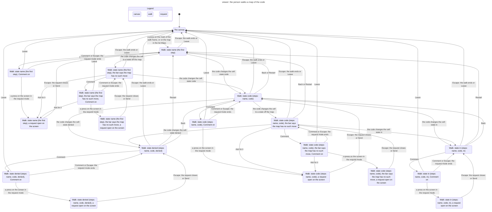

# viewer: the person walks a map of the code

The chart follows one tab while the person walks a map ([SPEC-prototype](../../SPEC-prototype.md)
ship 4, rules 8 and 9, E12 J1 to J5; the walk of [SPEC-flows](../../SPEC-flows.md) rules 19 to
24). The map starts at the state `name`. Its moves: `name` to `code`, `code` to `in`, `code` to
`denied`, and `denied` to `name`. The state `x` is a state that the code can reach and the map does
not have. The screen runs the real code, so a press can change the cell to any state. The person
starts the walk, goes Back, Restart and Leave, and asks for a change in the walk. The model is
[models/viewer/Walk.tla](models/viewer/Walk.tla) with [Walk.cfg](models/viewer/Walk.cfg)
(`TrustFramePost = FALSE`). TLC checks every rule below on all 19 of its states, and each one
holds. A walk has at most 3 steps in the model.

| Rule                       | In plain words                                                                                                 | Spec line                          |
| -------------------------- | -------------------------------------------------------------------------------------------------------------- | ---------------------------------- |
| `TypeOK`                   | Each value is one that the tab can hold. The canvas has no steps; the walk has one at least.                   | (model)                            |
| `EachStepIsAMove`          | The walk starts at the first state, and each next state comes from a move of the map from the state before it. | SPEC-prototype.md rule 9           |
| `BackShowsTheStateBefore`  | Back shows the state of the step before.                                                                       | SPEC-flows.md rule 20              |
| `OffMapKeepsTheState`      | When the code reaches a state that no move of the map reaches, the shown state stays, and the bar says so.     | SPEC-prototype.md decision 26 (J8) |
| `ARequestStaysOnItsScreen` | While a request is open in the walk, no step changes the screen: the request is on that screen.                | SPEC-flows.md rule 24 (J4)         |
| `NoLeaveWithARequestOpen`  | Escape with a request open closes the request, and the walk stays.                                             | SPEC-flows.md rule 20              |
| `NoDeadlock`               | There is always a next step.                                                                                   | (model)                            |

## What the model leaves out

- The run states (`pending`, `failed`, `done`): they are React state of a press, not a value of
  the cell, so they are not steps (SPEC-prototype decision 24).
- The pick of an answer of a call that waits: it is one way for the code to change the cell, as a
  press is.
- The address of the walk and a reload: deferred.
- The time to show the next state: the code changes the cell in the same document, with no load.
- The locale and the picks of each screen (J5): the walk draws as the canvas draws.

## What the chart shows

- Only a change of the cell to a state that a move of the map reaches, Back and Restart change
  the screen.
- A state off the map keeps the screen, and "Ask for it" opens a request there.
- A request opens on the screen that shows, and the walk takes no step until Send or Escape.
- [viewer-walk-any-post](viewer-walk-any-post.md) shows why the viewer checks each posted state
  against the map.
