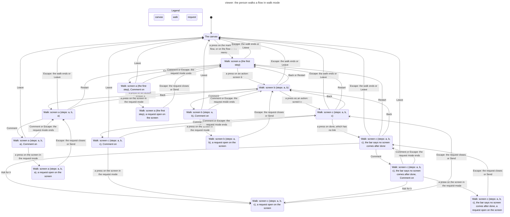

# viewer: the person walks a flow in walk mode

The chart follows one tab while the person walks a flow ([SPEC-flows](../../SPEC-flows.md) rules
16 to 24, J1 to J4). The flow starts at screen a. Its links: `send` of a leads to b, `next` of b
leads to c, and `back` of b leads to a. Screen c has the action `done` with no link, and screen x
is on the page with no link to it. The person starts the flow, presses the actions, goes Back,
Restart and Leave, and asks for a change in the walk. The model is
[models/viewer/Walk.tla](models/viewer/Walk.tla) with [Walk.cfg](models/viewer/Walk.cfg)
(`TrustFramePost = FALSE`). TLC checks every rule below on all 16 of its states, and each one
holds. A walk has at most 3 steps in the model.

| Rule                       | In plain words                                                                                       | Spec line                                      |
| -------------------------- | ---------------------------------------------------------------------------------------------------- | ---------------------------------------------- |
| `TypeOK`                   | Each value is one that the tab can hold. The canvas has no steps; the walk has one at least.         | (model)                                        |
| `EachStepIsALink`          | The walk starts at the first screen, and each next screen comes from a link of the screen before it. | SPEC-flows.md decision 5, rule 21; fact rule 3 |
| `BackShowsTheScreenBefore` | Back shows the screen of the step before.                                                            | SPEC-flows.md rule 20                          |
| `NoLinkKeepsTheScreen`     | A press on an action with no link keeps the screen, and the bar says so.                             | SPEC-flows.md rule 22                          |
| `ARequestStaysOnItsScreen` | While a request is open in the walk, no step changes the screen: the request is on that screen.      | SPEC-flows.md rule 24 (J4)                     |
| `NoLeaveWithARequestOpen`  | Escape with a request open closes the request, and the walk stays.                                   | SPEC-flows.md rule 20                          |
| `NoDeadlock`               | There is always a next step.                                                                         | (model)                                        |

## What the model leaves out

- The outline of the linked actions after a press off each action (rule 23): it changes no state.
- The address of the walk and a reload (rule 18): a reload opens the same steps.
- The time to show the next screen (rule 21): a browser test measures it.
- The locale and the picks of each screen (rule 25): the walk draws as the canvas does.
- A link that breaks while the person walks: [flows-links](flows-links.md) shows the links; a press
  on a broken link acts as a press on an action with no link.

## What the chart shows

- Only a press on an action with a link, Back and Restart change the screen.
- A request opens on the screen that shows, and the walk takes no step until Send or Escape.
- [viewer-walk-any-post](viewer-walk-any-post.md) shows why the viewer takes only an action name
  from the frame.
