# words: a live HTML frame shows the texts of the team in the pick, with a mark

The chart shows two HTML frames of one canvas in one tab ([SPEC-words.md](../../SPEC-words.md) §
The texts in a frame). One frame has an element with `data-easel-text="k"` and an own text. The
other frame has an own text only. The text key `k` has no `vi` text at revision 1 of the texts, and
has one at revision 2. The page composes a live HTML frame with the script of the texts only when
the frame has a text key, or the pick is not `en`. A new version, a new revision of the texts, or a
new pick that the document does not show gives a new document. In `vi`, the document marks each
text that it does not translate. The model is [models/words/Words.tla](models/words/Words.tla) with
[Words.cfg](models/words/Words.cfg).

```mermaid
---
title: "words: a live HTML frame shows the texts of the team in the pick, with a mark"
---
stateDiagram-v2
  state "Legend" as legend {
    lg0: away
    lg1: english
    lg2: marked
    lg3: behind
    lg4: stale
  }
  class lg0 tan
  class lg1 teal
  class lg2 yellow
  class lg3 blue
  class lg4 purple
  s0: Version 1, texts revision 1, English picked: the frame with a text key is not live
  s1: Version 2, texts revision 1, English picked: the frame with a text key is not live
  s2: Version 1, texts revision 2, English picked: the frame with a text key is not live
  s3: Version 1, texts revision 1, Vietnamese picked: the frame with a text key is not live
  s4: Version 1, texts revision 1, English picked: the frame shows its texts in English, with no mark
  s5: Version 2, texts revision 2, English picked: the frame with a text key is not live
  s6: Version 2, texts revision 1, Vietnamese picked: the frame with a text key is not live
  s7: Version 1, texts revision 2, Vietnamese picked: the frame with a text key is not live
  s8: Version 2, texts revision 1, English picked: the frame shows another version or another pick
  s9: Version 1, texts revision 2, English picked: the frame shows the texts of an older revision
  s10: Version 1, texts revision 1, Vietnamese picked: the frame shows another version or another pick
  s11: Version 1, texts revision 1, Vietnamese picked: the frame shows Vietnamese and marks the text key and the own text
  s12: Version 1, texts revision 2, English picked: the frame shows its texts in English, with no mark
  s13: Version 2, texts revision 1, English picked: the frame shows its texts in English, with no mark
  s14: Version 2, texts revision 2, Vietnamese picked: the frame with a text key is not live
  s15: Version 2, texts revision 2, English picked: the frame shows another version or another pick
  s16: Version 2, texts revision 1, Vietnamese picked: the frame shows another version or another pick
  s17: Version 1, texts revision 2, Vietnamese picked: the frame shows another version or another pick
  s18: Version 1, texts revision 1, English picked: the frame shows another version or another pick
  s19: Version 1, texts revision 2, Vietnamese picked: the frame shows the texts of an older revision
  s20: Version 1, texts revision 2, Vietnamese picked: the frame shows Vietnamese and marks the own text only
  s21: Version 2, texts revision 2, English picked: the frame shows the texts of an older revision
  s22: Version 2, texts revision 1, Vietnamese picked: the frame shows Vietnamese and marks the text key and the own text
  s23: Version 2, texts revision 2, English picked: the frame shows its texts in English, with no mark
  s24: Version 2, texts revision 2, Vietnamese picked: the frame shows another version or another pick
  s25: Version 1, texts revision 2, English picked: the frame shows another version or another pick
  s26: Version 2, texts revision 2, Vietnamese picked: the frame shows the texts of an older revision
  s27: Version 2, texts revision 2, Vietnamese picked: the frame shows Vietnamese and marks the own text only
  [*] --> s0
  s0 --> s1: an agent puts version 2
  s0 --> s2: an agent gives the vi text of the text key (texts.set)
  s0 --> s3: the person picks Vietnamese
  s0 --> s4: the frame with a text key comes into view: the page composes it
  s1 --> s5: an agent gives the vi text of the text key (texts.set)
  s1 --> s6: the person picks Vietnamese
  s1 --> s13: the frame with a text key comes into view: the page composes it
  s2 --> s5: an agent puts version 2
  s2 --> s7: the person picks Vietnamese
  s2 --> s12: the frame with a text key comes into view: the page composes it
  s3 --> s0: the person picks English
  s3 --> s6: an agent puts version 2
  s3 --> s7: an agent gives the vi text of the text key (texts.set)
  s3 --> s11: the frame with a text key comes into view: the page composes it
  s4 --> s0: the frame with a text key leaves the view
  s4 --> s8: an agent puts version 2
  s4 --> s9: an agent gives the vi text of the text key (texts.set)
  s4 --> s10: the person picks Vietnamese
  s5 --> s14: the person picks Vietnamese
  s5 --> s23: the frame with a text key comes into view: the page composes it
  s6 --> s1: the person picks English
  s6 --> s14: an agent gives the vi text of the text key (texts.set)
  s6 --> s22: the frame with a text key comes into view: the page composes it
  s7 --> s2: the person picks English
  s7 --> s14: an agent puts version 2
  s7 --> s20: the frame with a text key comes into view: the page composes it
  s8 --> s1: the frame with a text key leaves the view
  s8 --> s13: the page composes the frame with a text key again
  s8 --> s15: an agent gives the vi text of the text key (texts.set)
  s8 --> s16: the person picks Vietnamese
  s9 --> s2: the frame with a text key leaves the view
  s9 --> s12: the page composes the frame with a text key again
  s9 --> s15: an agent puts version 2
  s9 --> s17: the person picks Vietnamese
  s10 --> s3: the frame with a text key leaves the view
  s10 --> s4: the person picks English
  s10 --> s11: the page composes the frame with a text key again
  s10 --> s16: an agent puts version 2
  s10 --> s17: an agent gives the vi text of the text key (texts.set)
  s11 --> s3: the frame with a text key leaves the view
  s11 --> s18: the person picks English
  s11 --> s16: an agent puts version 2
  s11 --> s19: an agent gives the vi text of the text key (texts.set)
  s12 --> s2: the frame with a text key leaves the view
  s12 --> s15: an agent puts version 2
  s12 --> s17: the person picks Vietnamese
  s13 --> s1: the frame with a text key leaves the view
  s13 --> s21: an agent gives the vi text of the text key (texts.set)
  s13 --> s16: the person picks Vietnamese
  s14 --> s5: the person picks English
  s14 --> s27: the frame with a text key comes into view: the page composes it
  s15 --> s5: the frame with a text key leaves the view
  s15 --> s23: the page composes the frame with a text key again
  s15 --> s24: the person picks Vietnamese
  s16 --> s6: the frame with a text key leaves the view
  s16 --> s8: the person picks English
  s16 --> s22: the page composes the frame with a text key again
  s16 --> s24: an agent gives the vi text of the text key (texts.set)
  s17 --> s7: the frame with a text key leaves the view
  s17 --> s9: the person picks English
  s17 --> s20: the page composes the frame with a text key again
  s17 --> s24: an agent puts version 2
  s18 --> s0: the frame with a text key leaves the view
  s18 --> s4: the page composes the frame with a text key again
  s18 --> s11: the person picks Vietnamese
  s18 --> s8: an agent puts version 2
  s18 --> s25: an agent gives the vi text of the text key (texts.set)
  s19 --> s7: the frame with a text key leaves the view
  s19 --> s20: the page composes the frame with a text key again
  s19 --> s25: the person picks English
  s19 --> s24: an agent puts version 2
  s17 --> s12: the person picks English
  s20 --> s7: the frame with a text key leaves the view
  s20 --> s25: the person picks English
  s20 --> s24: an agent puts version 2
  s21 --> s5: the frame with a text key leaves the view
  s21 --> s23: the page composes the frame with a text key again
  s21 --> s24: the person picks Vietnamese
  s16 --> s13: the person picks English
  s22 --> s6: the frame with a text key leaves the view
  s22 --> s8: the person picks English
  s22 --> s26: an agent gives the vi text of the text key (texts.set)
  s23 --> s5: the frame with a text key leaves the view
  s23 --> s24: the person picks Vietnamese
  s24 --> s14: the frame with a text key leaves the view
  s24 --> s15: the person picks English
  s24 --> s27: the page composes the frame with a text key again
  s25 --> s2: the frame with a text key leaves the view
  s25 --> s12: the page composes the frame with a text key again
  s25 --> s19: the person picks Vietnamese
  s25 --> s15: an agent puts version 2
  s25 --> s20: the person picks Vietnamese
  s24 --> s21: the person picks English
  s8 --> s22: the person picks Vietnamese
  s26 --> s14: the frame with a text key leaves the view
  s26 --> s27: the page composes the frame with a text key again
  s26 --> s15: the person picks English
  s24 --> s23: the person picks English
  s27 --> s14: the frame with a text key leaves the view
  s27 --> s15: the person picks English
  s15 --> s26: the person picks Vietnamese
  s15 --> s27: the person picks Vietnamese
  class s0 tan
  class s1 tan
  class s2 tan
  class s3 tan
  class s4 teal
  class s5 tan
  class s6 tan
  class s7 tan
  class s8 blue
  class s9 purple
  class s10 blue
  class s11 yellow
  class s12 teal
  class s13 teal
  class s14 tan
  class s15 blue
  class s16 blue
  class s17 blue
  class s18 blue
  class s19 purple
  class s20 yellow
  class s21 purple
  class s22 yellow
  class s23 teal
  class s24 blue
  class s25 blue
  class s26 purple
  class s27 yellow
```

## Rules

- **APlainFrameInEnglishHasNoTexts:** a frame with no text key in `en` has no script of the texts,
  so a change of the texts cannot reach it, and it does not draw again (Q3).
- **ADocumentMarksOnlyWhatItDoesNotTranslate:** a live document marks the texts that its inputs do
  not translate, and no other.
- **EnglishHasNoMark:** a document in `en` has no mark.
- **ALiveFrameComesToShowTheTexts:** a live frame comes to show the current version, texts and
  pick, unless it leaves the view first.

## What the model leaves out

- The picture of a frame that is not live. It shows the first language and the own words of the
  frame (SPEC-words decision 11).
- App frames. Their locale is the chart [kit-frame-axes](kit-frame-axes.md), and their texts reach
  them on the kit message (SPEC-copy, L5).
- More than one text key, more than two locales, and other tabs: each tab keeps its own pick.
